# VidrierApp — Planificación de Tareas y Backlog para Trello

**Proyecto:** VidrierApp  
**Materia:** Desarrollo de Aplicaciones I · UADE · 2C 2026  
**Integrantes:** Leonardo Rodríguez (LU 1048084) · Facundo Reyes (LU 1111386)  
**Metodología:** Trunk-based development con feature branches atómicos integrados a `main` vía Pull Requests revisados.

---

## 1. Guía de Configuración del Tablero Trello

Para trasladar este backlog a Trello de forma inmediata, se recomienda configurar las siguientes columnas (listas) y etiquetas (labels):

### Columnas del Tablero (Workflow)
1. **📋 Product Backlog:** Banco general de tareas priorizadas por módulo.
2. **⏳ Sprint / To Do:** Tareas seleccionadas para la iteración actual (comprometidas).
3. **🏗️ In Progress:** Tareas en desarrollo activo (límite WIP recomendado: máximo 2 por desarrollador).
4. **👀 Code Review (PR):** Tareas con Pull Request abierto en GitHub pendiente de revisión del compañero.
5. **🧪 Testing & QA:** Verificación en emulador/dispositivo físico y validación de criterios de aceptación.
6. **✅ Done:** Tareas con PR mergeado en `main`, tests aprobados y criterios de aceptación cumplidos.

### Taxonomía de Etiquetas (Labels de Trello)
* 🟢 `App: Presentation` (Jetpack Compose, UI, Navegación)
* 🔵 `App: Domain & Data` (UseCases, Repositorios, Room, Retrofit)
* 🟣 `Hardware & Sensors` (GPS, Cámara, Filesystem)
* 🟠 `Backend & API` (Ktor/Spring, Endpoints, PostGIS)
* 🔴 `Web Lite & QR` (Formulario Vecino, ABM Locales)
* 🟡 `UX & Accesibilidad` (TalkBack, Contraste, Ergonomía 48dp)
* ⚪ `Testing & QA` (Tests unitarios, instrumentados)
* 🚨 `P0 - Bloqueante` / ⚠️ `P1 - Alta` / 💡 `P2 - Media`

---

## 2. Matriz Resumen de Tareas y Asignaciones

| ID | Título de la Tarea | Épica / Módulo | Asignado | Est. (Pts) | Prioridad |
| :--- | :--- | :--- | :--- | :---: | :---: |
| **INF-01** | Integrar SDK de Mapas y dependencias de Hardware en Gradle | Setup & Infra | Leonardo | 2 | 🚨 P0 |
| **INF-02** | Motor de Mocking y datos de prueba para desarrollo offline | Setup & Infra | Leonardo | 3 | 🚨 P0 |
| **MAP-01** | Implementar Composable interactivo de Mapa con Marcadores (RF01) | Módulo Mapa | Facundo | 5 | 🚨 P0 |
| **MAP-02** | Integrar Geolocalización GPS en Primer Plano y Fallback Manual (RNF-14) | Módulo Mapa | Leonardo | 5 | 🚨 P0 |
| **MAP-03** | Barra de Filtro Horizontal por Rubro y Estado Activo (RF02) | Módulo Mapa | Facundo | 3 | ⚠️ P1 |
| **MAP-04** | Tarjeta Bottom Preview de Local Seleccionado y Navegación rápida (RNF-02) | Módulo Mapa | Facundo | 3 | ⚠️ P1 |
| **DET-01** | Pantalla de Detalle de Local con Métricas de Demanda y Frecuencia (RF03) | Ficha Local | Facundo | 5 | 🚨 P0 |
| **DET-02** | Integración de Acciones de Contacto: Llamada, WhatsApp y Email | Ficha Local | Leonardo | 2 | ⚠️ P1 |
| **DET-03** | Lógica de Paywall y Bloqueo de Métricas Cuantitativas (RNF-06, RNF-07) | Ficha Local | Leonardo | 5 | 🚨 P0 |
| **VIS-01** | Contador Peatonal Ergonómico de 1-Toque en Bitácora (RF04, RNF-01) | Bitácora | Facundo | 3 | 🚨 P0 |
| **VIS-02** | Captura de Fotos con Cámara y Almacenamiento Seguro Local (RF04, RNF-08) | Bitácora | Leonardo | 5 | 🚨 P0 |
| **VIS-03** | Formulario de Notas y Persistencia Offline en Room (RF04, RNF-12) | Bitácora | Leonardo | 3 | 🚨 P0 |
| **VIS-04** | Historial de Visitas Pasadas del Local con Fotos y Fechas | Bitácora | Facundo | 3 | ⚠️ P1 |
| **UIX-01** | Sistema de Diseño M3, Alto Contraste y Áreas Táctiles 48dp (RNF-01, RNF-03) | UI/UX & Calidad | Facundo | 3 | ⚠️ P1 |
| **UIX-02** | Accesibilidad TalkBack y Escala de Fuentes Dinámica (RNF-04, RNF-11) | UI/UX & Calidad | Facundo | 3 | ⚠️ P1 |
| **UIX-03** | Manejo de Estado de Red, Banner Offline y Reintento (RNF-12) | UI/UX & Calidad | Facundo | 3 | ⚠️ P1 |
| **BE-01** | Modelo de Datos PostgreSQL con Extensión PostGIS y Esquema JSONB | Backend & Cloud | Leonardo | 5 | 🚨 P0 |
| **BE-02** | API REST Ktor/Spring: Endpoints de Locales, Votos y Filtrado por Pase | Backend & Cloud | Leonardo | 5 | 🚨 P0 |
| **BE-03** | Pipeline de Normalización Determinística y Fuzzy Matching | Backend & Cloud | Leonardo | 5 | ⚠️ P1 |
| **BE-04** | Worker Asíncrono de Excepciones para Textos No Clasificados | Backend & Cloud | Leonardo | 3 | 💡 P2 |
| **WEB-01** | Formulario Web Responsive Ultra-Liviano de Voto Barrial (Vecino) | Web Lite | Facundo | 5 | 🚨 P0 |
| **WEB-02** | Consola Básica de Administración ABM de Locales y Generador de QR | Web Lite | Leonardo | 5 | ⚠️ P1 |
| **QA-01** | Pruebas Unitarias de Arquitectura (UseCases, ViewModels y Mappers) | Calidad & Tests | Leonardo | 3 | ⚠️ P1 |
| **QA-02** | Pruebas de Persistencia Room y Pruebas de Interfaz Compose | Calidad & Tests | Facundo | 3 | ⚠️ P1 |

---

## 3. Detalle Completo de Tarjetas para Trello (Cards)

> **Instrucción para Trello:** Cada tarjeta puede copiarse y pegarse directamente en el cuerpo de una tarjeta de Trello. Los bloques de checklist `[ ]` son interpretados de forma nativa por Trello al pegarlos en un campo de checklist.

---

### ÉPICA 1: SETUP, INFRAESTRUCTURA & ARQUITECTURA ANDROID

---

#### [INF-01] Integrar SDK de Mapas y dependencias de Hardware en Gradle
* **Lista Trello:** 📋 Product Backlog / Sprint 1
* **Asignado a:** Leonardo Rodríguez (`@leo`)
* **Etiquetas:** `App: Domain & Data`, `Hardware & Sensors`, `🚨 P0 - Bloqueante`
* **Estimación:** 2 Puntos de Historia
* **Descripción:**  
  Agregar a `gradle/libs.versions.toml` y `app/build.gradle.kts` las dependencias necesarias para renderizar mapas interactivos (Google Maps Compose SDK o MapLibre/OSM), servicios de ubicación de Google Play Services (`play-services-location`), y librerías de soporte de cámara/imágenes (CameraX o Coil para cargar imágenes locales en Jetpack Compose).
* **Archivos Afectados:**
  * `gradle/libs.versions.toml`
  * `app/build.gradle.kts`
  * `app/src/main/AndroidManifest.xml`
* **Checklist de Aceptación:**
  - [ ] Añadir versión y dependencias de Maps SDK para Jetpack Compose en `libs.versions.toml`.
  - [ ] Añadir dependencias de `play-services-location` para el rastreo GPS en foreground.
  - [ ] Añadir Coil Compose (`io.coil-kt:coil-compose`) para visualización fluida de fotos locales.
  - [ ] Configurar permisos de cámara y ubicación en `AndroidManifest.xml` con descripción de uso.
  - [ ] Validar que `./gradlew assembleDebug` compile limpiamente sin conflictos de dependencias.

---

#### [INF-02] Motor de Mocking y datos de prueba para desarrollo offline
* **Lista Trello:** 📋 Product Backlog / Sprint 1
* **Asignado a:** Leonardo Rodríguez (`@leo`)
* **Etiquetas:** `App: Domain & Data`, `Testing & QA`, `🚨 P0 - Bloqueante`
* **Estimación:** 3 Puntos de Historia
* **Descripción:**  
  Configurar un interceptor de red o repositorio simulado en `AppContainer` que entregue datos de prueba realistas representativos de los casos de estudio (Mataderos y Haedo), permitiendo a la UI desarrollar y probar pantallas completas sin depender de que el backend remoto esté desplegado en la nube.
* **Archivos Afectados:**
  * `app/src/main/kotlin/com/vidrierapp/di/AppContainer.kt`
  * `app/src/main/kotlin/com/vidrierapp/data/repository/RetrofitShopRepository.kt`
  * `app/src/main/assets/mock_shops.json` (o MockInterceptor en OkHttp)
* **Checklist de Aceptación:**
  - [ ] Crear dataset JSON con locales en Mataderos (ej. Av. Juan Bautista Alberdi) y Haedo (ej. Av. Rivadavia) con datos de superficie, precio, inmobiliaria y distribución de votos.
  - [ ] Incluir caso del local con 58 votos (34 Cafetería, 15 Verdulería, 9 Panadería) y frecuencia diaria (21/34).
  - [ ] Configurar un `MockInterceptor` opcional en OkHttp activable vía flag de debug en `AppContainer`.
  - [ ] Verificar que `GetShopsUseCase` y `GetShopDetailUseCase` emitan datos simulados de forma transparente.

---

### ÉPICA 2: MÓDULO DE MAPA Y GEOLOCALIZACIÓN (RF01, RF02)

---

#### [MAP-01] Implementar Composable interactivo de Mapa con Marcadores (RF01)
* **Lista Trello:** 📋 Product Backlog / Sprint 2
* **Asignado a:** Facundo Reyes (`@facundo`)
* **Etiquetas:** `App: Presentation`, `UX & Accesibilidad`, `🚨 P0 - Bloqueante`
* **Estimación:** 5 Puntos de Historia
* **Descripción:**  
  Reemplazar el placeholder de `MapScreen.kt` por un mapa interactivo funcional que renderice marcadores para los locales comerciales. Cada pin debe representar visualmente el rubro con mayor demanda o un indicador de alta demanda barrial.
* **Requisitos Vinculados:** RF01, RNF-01 (área de toque >= 48dp), RNF-05 (renderizado < 2s).
* **Archivos Afectados:**
  * `app/src/main/kotlin/com/vidrierapp/presentation/map/MapScreen.kt`
  * `app/src/main/kotlin/com/vidrierapp/presentation/map/MapViewModel.kt`
  * `app/src/main/kotlin/com/vidrierapp/presentation/map/MapUiState.kt`
* **Checklist de Aceptación:**
  - [ ] Integrar el componente de mapa en `MapScreen` vinculado a las coordenadas del estado `MapUiState.Success`.
  - [ ] Dibujar marcadores personalizados para cada local comercial mostrando icono/color del rubro líder (`topCategory`).
  - [ ] Asegurar que el área táctil del pin cumpla con los 48x48 dp mínimos requeridos (RNF-01).
  - [ ] Al pulsar un marcador, emitir el evento `selectShop(shop)` en el ViewModel y centrar la cámara en el local.
  - [ ] Controlar el ciclo de vida del mapa en Compose para optimizar el rendimiento y evitar fugas de memoria.

---

#### [MAP-02] Integrar Geolocalización GPS en Primer Plano y Fallback Manual (RNF-14)
* **Lista Trello:** 📋 Product Backlog / Sprint 2
* **Asignado a:** Leonardo Rodríguez (`@leo`)
* **Etiquetas:** `Hardware & Sensors`, `App: Domain & Data`, `🚨 P0 - Bloqueante`
* **Estimación:** 5 Puntos de Historia
* **Descripción:**  
  Implementar la captura contextual de ubicación del dispositivo exclusivamente en primer plano (foreground). Al abrir la app, solicitar permisos en tiempo de ejecución. Si se conceden, centrar el mapa en la posición actual del emprendedor; si se rechazan, mostrar un campo de texto para buscar manualmente por barrio (ej. "Mataderos", "Haedo").
* **Requisitos Vinculados:** RNF-14, RNF-02.
* **Archivos Afectados:**
  * `app/src/main/kotlin/com/vidrierapp/presentation/map/MapScreen.kt`
  * `app/src/main/kotlin/com/vidrierapp/presentation/map/MapViewModel.kt`
  * `app/src/main/kotlin/com/vidrierapp/presentation/map/MapUiState.kt`
* **Checklist de Aceptación:**
  - [ ] Gestionar la solicitud de permisos `ACCESS_FINE_LOCATION` y `ACCESS_COARSE_LOCATION` con `rememberLauncherForActivityResult`.
  - [ ] Conectar `FusedLocationProviderClient` para obtener la última ubicación conocida al iniciar la pantalla.
  - [ ] Añadir botón flotante "Mi Ubicación" accesible con el pulgar para re-centrar el mapa.
  - [ ] Si el usuario rechaza los permisos, mostrar barra de búsqueda manual sin bloquear la navegación.
  - [ ] Implementar búsqueda y geocodificación básica o filtrado local por nombre de barrio (Mataderos, Haedo).

---

#### [MAP-03] Barra de Filtro Horizontal por Rubro y Estado Activo (RF02)
* **Lista Trello:** 📋 Product Backlog / Sprint 2
* **Asignado a:** Facundo Reyes (`@facundo`)
* **Etiquetas:** `App: Presentation`, `UX & Accesibilidad`, `⚠️ P1 - Alta`
* **Estimación:** 3 Puntos de Historia
* **Descripción:**  
  Construir un selector horizontal de chips en la parte superior del mapa que permita filtrar los locales mostrados según el rubro de interés ("Todos", "Cafetería", "Verdulería", "Panadería", etc.). Al seleccionar un rubro, el mapa debe actualizar los pines visibles de forma inmediata.
* **Requisitos Vinculados:** RF02, RNF-02 (máximo 2 toques).
* **Archivos Afectados:**
  * `app/src/main/kotlin/com/vidrierapp/presentation/map/MapScreen.kt`
  * `app/src/main/kotlin/com/vidrierapp/presentation/map/MapViewModel.kt`
* **Checklist de Aceptación:**
  - [ ] Diseñar fila horizontal deslizable (`LazyRow`) de `FilterChip` Material 3 accesible en movimiento.
  - [ ] Resaltar visualmente el chip activo con contraste superior a 4.5:1.
  - [ ] Invocar `MapViewModel.loadShops(categoryFilter)` al cambiar la selección.
  - [ ] Ocultar o atenuar del mapa los locales donde el rubro seleccionado no tenga votos preponderantes.
  - [ ] Manejar estado vacío si ningún local coincide con el filtro (`R.string.map_no_shops_found`).

---

#### [MAP-04] Tarjeta Bottom Preview de Local Seleccionado y Navegación Rápida (RNF-02)
* **Lista Trello:** 📋 Product Backlog / Sprint 2
* **Asignado a:** Facundo Reyes (`@facundo`)
* **Etiquetas:** `App: Presentation`, `UX & Accesibilidad`, `⚠️ P1 - Alta`
* **Estimación:** 3 Puntos de Historia
* **Descripción:**  
  Al hacer clic en un pin del mapa, desplegar en la parte inferior de la pantalla una tarjeta resumen (Bottom Card o Modal Bottom Sheet) con los datos clave del local: dirección, barrio, rubro más votado, total de votos y botón directo para "Ver ficha completa".
* **Requisitos Vinculados:** RF01, RNF-02 (navegación en máximo 2 toques hacia el detalle).
* **Archivos Afectados:**
  * `app/src/main/kotlin/com/vidrierapp/presentation/map/MapScreen.kt`
  * `app/src/main/kotlin/com/vidrierapp/presentation/map/MapUiState.kt`
* **Checklist de Aceptación:**
  - [ ] Crear composable `ShopPreviewCard` fijado en la parte inferior de la pantalla.
  - [ ] Mostrar dirección (`shop.address`), barrio (`shop.neighborhood`), rubro líder y badge con votos.
  - [ ] Botón de acción principal "Ver ficha completa" con altura mínima de 48 dp.
  - [ ] Al presionar la tarjeta o el botón, ejecutar `onShopClick(shop.id)` navegando a `ShopDetailScreen`.
  - [ ] Permitir cerrar la tarjeta tocando fuera de ella o deslizándola hacia abajo.

---

### ÉPICA 3: FICHA DE DETALLE, MÉTRICAS Y PAYWALL (RF03, RNF-06, RNF-07)

---

#### [DET-01] Pantalla de Detalle de Local con Métricas de Demanda y Frecuencia (RF03)
* **Lista Trello:** 📋 Product Backlog / Sprint 3
* **Asignado a:** Facundo Reyes (`@facundo`)
* **Etiquetas:** `App: Presentation`, `UX & Accesibilidad`, `🚨 P0 - Bloqueante`
* **Estimación:** 5 Puntos de Historia
* **Descripción:**  
  Implementar la interfaz completa de `ShopDetailScreen.kt` organizada en secciones claras: Cabecera del inmueble (dirección, fotos, superficie en m², canon de alquiler), Distribución de Demanda Barrial (gráfico/barras de votos por rubro con porcentajes) e Indicadores de Frecuencia de Consumo (Diaria, Semanal, Mensual).
* **Requisitos Vinculados:** RF03, RNF-03, RNF-04.
* **Archivos Afectados:**
  * `app/src/main/kotlin/com/vidrierapp/presentation/detail/ShopDetailScreen.kt`
  * `app/src/main/kotlin/com/vidrierapp/presentation/detail/ShopDetailViewModel.kt`
  * `app/src/main/kotlin/com/vidrierapp/presentation/detail/ShopDetailUiState.kt`
* **Checklist de Aceptación:**
  - [ ] Crear vista con `LazyColumn` y diseño limpio de fichas técnicas para exteriores.
  - [ ] Renderizar barras de progreso horizontales para cada rubro votado indicando cantidad y porcentaje relativo.
  - [ ] Implementar sección de frecuencia de consumo (ej. "21 de 34 asistirían a diario").
  - [ ] Añadir botón destacado "Registrar Visita Técnica" (`R.string.detail_btn_log_visit`) que dirija a `LogVisitDestination`.
  - [ ] Configurar botón de retorno "Volver" en la barra superior (`TopAppBar`) que llame a `onBackClick()`.

---

#### [DET-02] Integración de Acciones de Contacto: Llamada, WhatsApp y Email
* **Lista Trello:** 📋 Product Backlog / Sprint 3
* **Asignado a:** Leonardo Rodríguez (`@leo`)
* **Etiquetas:** `App: Presentation`, `Hardware & Sensors`, `⚠️ P1 - Alta`
* **Estimación:** 2 Puntos de Historia
* **Descripción:**  
  Conectar los botones de contacto de la inmobiliaria en la ficha del local con las aplicaciones nativas del sistema operativo utilizando Intents implícitos de Android (Marcador telefónico `tel:`, API de WhatsApp `https://wa.me/` y cliente de correo `mailto:`).
* **Requisitos Vinculados:** Alcance Doc (Contacto inmobiliaria).
* **Archivos Afectados:**
  * `app/src/main/kotlin/com/vidrierapp/presentation/detail/ShopDetailScreen.kt`
* **Checklist de Aceptación:**
  - [ ] Botón "Llamar": disparar `Intent.ACTION_DIAL` con URI `tel:<telefono_inmobiliaria>`.
  - [ ] Botón "WhatsApp": disparar `Intent.ACTION_VIEW` con URI `https://api.whatsapp.com/send?phone=...&text=Hola, consulto por el local en <direccion>`.
  - [ ] Botón "Email": disparar `Intent.ACTION_SENDTO` con URI `mailto:<email_inmobiliaria>` y asunto precompletado.
  - [ ] Manejar `ActivityNotFoundException` de forma segura mediante Snackbar si no existe app disponible.
  - [ ] Validar que todos los botones de contacto tengan un área de toque no menor a 48x48 dp.

---

#### [DET-03] Lógica de Paywall y Bloqueo de Métricas Cuantitativas (RNF-06, RNF-07)
* **Lista Trello:** 📋 Product Backlog / Sprint 3
* **Asignado a:** Leonardo Rodríguez (`@leo`)
* **Etiquetas:** `App: Domain & Data`, `App: Presentation`, `🚨 P0 - Bloqueante`
* **Estimación:** 5 Puntos de Historia
* **Descripción:**  
  Implementar la regla de negocio y componente de UI que bloquea la visualización de métricas cuantitativas (votos exactos, porcentajes y frecuencias) si el usuario no tiene una prueba activa de 3 días o un pase de 30 días vigente. La app debe mostrar una tarjeta de invitación a activar la prueba o pase, verificando la unicidad del dispositivo mediante Hardware/Device ID.
* **Requisitos Vinculados:** RNF-06, RNF-07.
* **Archivos Afectados:**
  * `app/src/main/kotlin/com/vidrierapp/domain/model/Shop.kt`
  * `app/src/main/kotlin/com/vidrierapp/presentation/detail/ShopDetailScreen.kt`
  * `app/src/main/kotlin/com/vidrierapp/presentation/detail/ShopDetailViewModel.kt`
  * `app/src/main/kotlin/com/vidrierapp/data/local/` (Preferencias de usuario / Device UUID)
* **Checklist de Aceptación:**
  - [ ] Almacenar localmente el estado de la suscripción (Días de prueba restantes / Pase activo / Inactivo).
  - [ ] Generar y almacenar un identificador único de instalación/hardware persistente.
  - [ ] En la UI de Detalle, si el pase no está activo, reemplazar el desglose numérico por un componente de blur/candado con `R.string.pass_locked_title` y botón de activación.
  - [ ] Implementar flujo simulado de activación de prueba gratuita (3 días) de un solo uso por dispositivo.
  - [ ] Implementar flujo simulado de compra de Pase de 30 días sin renovación automática.
  - [ ] Comprobar que tras la activación, la pantalla desbloquee inmediatamente las métricas completas.

---

### ÉPICA 4: BITÁCORA DE RELEVAMIENTO TÉCNICO OFFLINE (RF04, RNF-08, RNF-12)

---

#### [VIS-01] Contador Peatonal Ergonómico de 1-Toque en Bitácora (RF04, RNF-01)
* **Lista Trello:** 📋 Product Backlog / Sprint 4
* **Asignado a:** Facundo Reyes (`@facundo`)
* **Etiquetas:** `App: Presentation`, `UX & Accesibilidad`, `🚨 P0 - Bloqueante`
* **Estimación:** 3 Puntos de Historia
* **Descripción:**  
  Desarrollar el control de conteo peatonal dentro de `LogVisitScreen.kt` optimizado para operación con una sola mano en movimiento en la vereda. Debe constar de un botón de gran tamaño (`+`) fácil de pulsar sin mirar fijamente la pantalla, acompañado de respuesta háptica (vibración) y contador visual de alto contraste.
* **Requisitos Vinculados:** RF04, RNF-01, Contexto de uso Weiser.
* **Archivos Afectados:**
  * `app/src/main/kotlin/com/vidrierapp/presentation/visit/LogVisitScreen.kt`
  * `app/src/main/kotlin/com/vidrierapp/presentation/visit/VisitViewModel.kt`
* **Checklist de Aceptación:**
  - [ ] Diseñar botón de incremento `+` con área táctil superior a 64x64 dp para uso con pulgar.
  - [ ] Conectar la acción a `VisitViewModel.incrementPedestrians()`.
  - [ ] Incorporar `HapticFeedbackType.LongPress` para que el usuario sienta el registro del conteo en la mano.
  - [ ] Proveer botón secundario más pequeño para restar (`-`) en caso de error involuntario.
  - [ ] Incluir TalkBack `contentDescription` descriptivo que anuncie el total actualizado de peatones.

---

#### [VIS-02] Captura de Fotos con Cámara y Almacenamiento Seguro Local (RF04, RNF-08)
* **Lista Trello:** 📋 Product Backlog / Sprint 4
* **Asignado a:** Leonardo Rodríguez (`@leo`)
* **Etiquetas:** `Hardware & Sensors`, `App: Domain & Data`, `🚨 P0 - Bloqueante`
* **Estimación:** 5 Puntos de Historia
* **Descripción:**  
  Implementar la captura de imágenes fotográficas de la vidriera y estado del local utilizando `ActivityResultContracts.TakePicture()` con un `FileProvider` seguro en almacenamiento privado de la app. Las imágenes deben guardarse únicamente en el dispositivo local, garantizando la privacidad del comerciante.
* **Requisitos Vinculados:** RF04, RNF-08 (Privacidad estricta, sin subida a la nube).
* **Archivos Afectados:**
  * `app/src/main/kotlin/com/vidrierapp/presentation/visit/LogVisitScreen.kt`
  * `app/src/main/kotlin/com/vidrierapp/presentation/visit/VisitViewModel.kt`
  * `app/src/main/AndroidManifest.xml`
  * `app/src/main/res/xml/file_paths.xml`
* **Checklist de Aceptación:**
  - [ ] Configurar `androidx.core.content.FileProvider` en `AndroidManifest.xml` con directorio `files-path/visit_photos`.
  - [ ] Crear launcher de cámara en `LogVisitScreen` que cree un archivo temporal y lance la app de cámara.
  - [ ] Al completar la captura, almacenar la URI interna en `VisitUiState.photoUris`.
  - [ ] Renderizar miniaturas horizontales (`LazyRow`) de las fotos capturadas con opción de eliminarlas.
  - [ ] Asegurar que ninguna foto se transmita por red bajo ninguna circunstancia (RNF-08).

---

#### [VIS-03] Formulario de Notas y Persistencia Offline en Room (RF04, RNF-12)
* **Lista Trello:** 📋 Product Backlog / Sprint 4
* **Asignado a:** Leonardo Rodríguez (`@leo`)
* **Etiquetas:** `App: Domain & Data`, `App: Presentation`, `🚨 P0 - Bloqueante`
* **Estimación:** 3 Puntos de Historia
* **Descripción:**  
  Completar el guardado de la visita técnica en la base de datos Room (`VidrierAppDatabase` / `VisitDao`). La bitácora debe almacenar el texto de notas, la fecha y hora, el conteo peatonal y la lista de rutas de fotos locales, funcionando en modo 100% offline sin necesidad de conexión.
* **Requisitos Vinculados:** RF04, RNF-12 (Preservación del estado ante fallas).
* **Archivos Afectados:**
  * `app/src/main/kotlin/com/vidrierapp/data/local/dao/VisitDao.kt`
  * `app/src/main/kotlin/com/vidrierapp/data/local/entity/VisitEntity.kt`
  * `app/src/main/kotlin/com/vidrierapp/data/repository/RoomVisitRepository.kt`
  * `app/src/main/kotlin/com/vidrierapp/presentation/visit/VisitViewModel.kt`
* **Checklist de Aceptación:**
  - [ ] Campo de texto `OutlinedTextField` para observaciones de campo con guardado en tiempo real en ViewModel.
  - [ ] Al pulsar "Guardar Visita en Dispositivo", persistir la entidad en Room a través de `LogVisitUseCase`.
  - [ ] Mostrar mensaje de confirmación exitoso (`R.string.visit_save_success`) y limpiar el formulario para nuevas entradas.
  - [ ] Garantizar que si la app se suspende o se corta la conexión, el borrador escrito no se pierda (RNF-12).
  - [ ] Testear inserción y recuperación en Room con base de datos en memoria (`Room.inMemoryDatabaseBuilder`).

---

#### [VIS-04] Historial de Visitas Pasadas del Local con Fotos y Fechas
* **Lista Trello:** 📋 Product Backlog / Sprint 4
* **Asignado a:** Facundo Reyes (`@facundo`)
* **Etiquetas:** `App: Presentation`, `UX & Accesibilidad`, `⚠️ P1 - Alta`
* **Estimación:** 3 Puntos de Historia
* **Descripción:**  
  Renderizar al final de la pantalla de bitácora el listado cronológico de visitas previas realizadas a ese local comercial específico (`pastVisits`), permitiendo al emprendedor revisar sus observaciones y fotos de días u horarios anteriores para comparar el flujo de la zona.
* **Requisitos Vinculados:** RF04, RNF-08.
* **Archivos Afectados:**
  * `app/src/main/kotlin/com/vidrierapp/presentation/visit/LogVisitScreen.kt`
  * `app/src/main/kotlin/com/vidrierapp/presentation/visit/VisitUiState.kt`
* **Checklist de Aceptación:**
  - [ ] Cargar automáticamente las visitas de Room vinculadas al `shopId` vía `GetVisitsUseCase(shopId)`.
  - [ ] Renderizar tarjeta para cada visita con: fecha legible (ej. "22 Nov 2026, 15:30"), peatones y notas.
  - [ ] Mostrar minigalería de fotos adjuntas para cada visita pasada.
  - [ ] Mostrar mensaje vacío amigable si es la primera visita al local (`R.string.visit_no_entries`).

---

### ÉPICA 5: SISTEMA DE DISEÑO, ACCESIBILIDAD Y RESILIENCIA (RNF-01 a RNF-12)

---

#### [UIX-01] Sistema de Diseño M3, Alto Contraste y Áreas Táctiles 48dp (RNF-01, RNF-03)
* **Lista Trello:** 📋 Product Backlog / Sprint 5
* **Asignado a:** Facundo Reyes (`@facundo`)
* **Etiquetas:** `UX & Accesibilidad`, `App: Presentation`, `⚠️ P1 - Alta`
* **Estimación:** 3 Puntos de Historia
* **Descripción:**  
  Auditar y consolidar los componentes visuales de Jetpack Compose en `Color.kt` y `Theme.kt`. Asegurar que todas las combinaciones de color de texto y superficie cumplan un ratio de contraste mínimo de 4.5:1 bajo luz solar directa, y que todo elemento cliqueable tenga una dimensión mínima de 48 x 48 dp.
* **Requisitos Vinculados:** RNF-01, RNF-03.
* **Archivos Afectados:**
  * `app/src/main/kotlin/com/vidrierapp/presentation/theme/Color.kt`
  * `app/src/main/kotlin/com/vidrierapp/presentation/theme/Theme.kt`
  * Todos los Composables de pantallas.
* **Checklist de Aceptación:**
  - [ ] Validar con herramienta de contraste WCAG que los pares texto/fondo superen el ratio 4.5:1.
  - [ ] Aplicar modificador `Modifier.sizeIn(minWidth = 48.dp, minHeight = 48.dp)` en todos los `IconButton`, chips y marcadores.
  - [ ] Definir estilos visualmente atenuados de contraste reducido específicamente para información en caché o no actualizada.
  - [ ] Probar la interfaz al aire libre o con brillo elevado para validar legibilidad.

---

#### [UIX-02] Accesibilidad TalkBack y Escala de Fuentes Dinámica (RNF-04, RNF-11)
* **Lista Trello:** 📋 Product Backlog / Sprint 5
* **Asignado a:** Facundo Reyes (`@facundo`)
* **Etiquetas:** `UX & Accesibilidad`, `App: Presentation`, `⚠️ P1 - Alta`
* **Estimación:** 3 Puntos de Historia
* **Descripción:**  
  Garantizar el 100% de cobertura de accesibilidad con TalkBack mediante `contentDescription` descriptivos en todos los iconos y controles. Verificar que no existan textos hardcodeados (100% en `strings.xml`) y que la tipografía responda a las opciones de escala de texto del sistema operativo.
* **Requisitos Vinculados:** RNF-04, RNF-11.
* **Archivos Afectados:**
  * `app/src/main/res/values/strings.xml`
  * `app/src/main/kotlin/com/vidrierapp/presentation/theme/Type.kt`
  * Composables de UI.
* **Checklist de Aceptación:**
  - [ ] Ejecutar auditoría de lint para confirmar 0 strings literales hardcodeados en código Kotlin.
  - [ ] Configurar propiedades semánticas (`Modifier.semantics`) en tarjetas complejas para que TalkBack lea el bloque completo de forma coherente.
  - [ ] Usar unidades tipográficas relativas (`sp`) en `Type.kt` sin tamaños fijos en `dp`.
  - [ ] Realizar una sesión de prueba navegando con el lector TalkBack activado en emulador.

---

#### [UIX-03] Manejo de Estado de Red, Banner Offline y Reintento (RNF-12)
* **Lista Trello:** 📋 Product Backlog / Sprint 5
* **Asignado a:** Facundo Reyes (`@facundo`)
* **Etiquetas:** `App: Presentation`, `UX & Accesibilidad`, `⚠️ P1 - Alta`
* **Estimación:** 3 Puntos de Historia
* **Descripción:**  
  Diseñar y vincular en el layout global un Banner de Estado Offline ("Modo sin conexión. Mostrando datos almacenados en el dispositivo") y tarjetas de error con botón explícito de "Reintentar" cuando falle una petición a la API de locales, asegurando que la app no quede en blanco ni trabada.
* **Requisitos Vinculados:** RNF-12, Contexto de uso Weiser.
* **Archivos Afectados:**
  * `app/src/main/kotlin/com/vidrierapp/presentation/map/MapScreen.kt`
  * `app/src/main/kotlin/com/vidrierapp/presentation/detail/ShopDetailScreen.kt`
  * `app/src/main/kotlin/com/vidrierapp/presentation/common/OfflineBanner.kt`
* **Checklist de Aceptación:**
  - [ ] Crear composable reutilizable `OfflineBanner` que se dibuje bajo la barra superior cuando no haya red.
  - [ ] Implementar pantalla de error con icono claro, mensaje y botón `R.string.action_retry`.
  - [ ] Al pulsar "Reintentar", re-ejecutar la petición fallida sin recargar toda la navegación.
  - [ ] Probar interrupción brusca de red (modo avión) validando que la app mantenga la información visible.

---

### ÉPICA 6: BACKEND, POSTGIS & NORMALIZACIÓN DE VOTOS (INFRAESTRUCTURA CLOUD)

---

#### [BE-01] Modelo de Datos PostgreSQL con Extensión PostGIS y Esquema JSONB
* **Lista Trello:** 📋 Product Backlog / Sprint 6
* **Asignado a:** Leonardo Rodríguez (`@leo`)
* **Etiquetas:** `Backend & API`, `🚨 P0 - Bloqueante`
* **Estimación:** 5 Puntos de Historia
* **Descripción:**  
  Configurar la base de datos PostgreSQL del backend con la extensión geoespacial PostGIS habilitada. Crear las tablas de `locales` (con campo `geometria` tipo `GEOMETRY(Point, 4326)` e índice espacial GiST), `votos` (rubro normalizado, timestamp, huella anónima) y `pases` (control de trial por device ID y compras de 30 días).
* **Requisitos Vinculados:** ADR 4.1, RNF-07, RNF-09.
* **Entregables:**
  * Scripts de migración SQL / Flyway o Liquibase.
  * Modelo relacional con índices espaciales (`ST_DWithin`, `ST_MakeEnvelope`).
* **Checklist de Aceptación:**
  - [ ] Crear base de datos PostgreSQL y habilitar extensión `postgis`.
  - [ ] Crear tabla `shops` con columnas de latitud, longitud, geometría PostGIS y campo `attributes` en formato `JSONB`.
  - [ ] Crear tabla `votes` vinculada a `shop_id` con rubro normalizado y métrica de frecuencia de consumo.
  - [ ] Crear tabla `device_trials` con hardware ID para garantizar 1 único trial de 3 días por dispositivo.
  - [ ] Validar consulta espacial para obtener locales dentro de un bounding box en menos de 50ms.

---

#### [BE-02] API REST Ktor/Spring: Endpoints de Locales, Votos y Filtrado por Pase
* **Lista Trello:** 📋 Product Backlog / Sprint 6
* **Asignado a:** Leonardo Rodríguez (`@leo`)
* **Etiquetas:** `Backend & API`, `🚨 P0 - Bloqueante`
* **Estimación:** 5 Puntos de Historia
* **Descripción:**  
  Construir los endpoints REST de la API central: `GET /api/v1/shops` (filtro por categoría y coordenadas visibles), `GET /api/v1/shops/{id}` (detalle del local), `POST /api/v1/votes` (captura de voto barrial) y `POST /api/v1/auth/trial` (activación de pase). Implementar la lógica del servidor que censura las métricas exactas si la petición no incluye un token de pase válido.
* **Requisitos Vinculados:** RNF-06, RNF-07, ADR 3.2.
* **Archivos / Módulos:**
  * Controladores y servicios REST backend en Kotlin.
* **Checklist de Aceptación:**
  - [ ] Endpoint `GET /api/v1/shops` con soporte de parámetros de búsqueda (`category`, `bbox`).
  - [ ] Endpoint `GET /api/v1/shops/{id}` que devuelva desglose completo solo si el header de autorización contiene un pase activo; en caso contrario, omitir el array `votes`.
  - [ ] Endpoint `POST /api/v1/auth/trial` que verifique en DB que el `device_id` no haya sido utilizado previamente.
  - [ ] Serialización JSON compatible 100% con los DTOs de Android (`ShopDto`, `VoteDto`).
  - [ ] Pruebas de integración HTTP de los endpoints con Postman o tests automatizados.

---

#### [BE-03] Pipeline de Normalización Determinística y Fuzzy Matching
* **Lista Trello:** 📋 Product Backlog / Sprint 6
* **Asignado a:** Leonardo Rodríguez (`@leo`)
* **Etiquetas:** `Backend & API`, `⚠️ P1 - Alta`
* **Estimación:** 5 Puntos de Historia
* **Descripción:**  
  Implementar el pipeline en tiempo real que procesa los votos de texto libre ingresados por los vecinos en la opción "Otro" del formulario web. El pipeline debe aplicar sanitización, eliminación de tildes/espacios, mapeo por diccionario de sinónimos y coincidencia difusa (algoritmo Levenshtein) para categorizar el ~95% de las respuestas en milisegundos sin costo.
* **Requisitos Vinculados:** ADR 3.1, Arquitectura backend.
* **Entregables:**
  * Módulo `NormalizationService` en el backend.
  * Tabla / Diccionario de alias de rubros (ej. "cafe", "cafecito", "coffee" $\rightarrow$ "Cafetería").
* **Checklist de Aceptación:**
  - [ ] Implementar paso 1: Sanitización básica (lowercase, trim, regex para caracteres especiales y tildes).
  - [ ] Implementar paso 2: Búsqueda exacta contra tabla de alias preconfigurada.
  - [ ] Implementar paso 3: Algoritmo Levenshtein con umbral de tolerancia para errores ortográficos comunes.
  - [ ] Si la distancia supera el umbral, marcar el registro como `unclassified` para el batch nocturno.
  - [ ] Tests unitarios con casos extremos de tipeo (ej. "verduleris", "panadria", "gim").

---

#### [BE-04] Worker Asíncrono de Excepciones para Textos No Clasificados
* **Lista Trello:** 📋 Product Backlog / Sprint 6
* **Asignado a:** Leonardo Rodríguez (`@leo`)
* **Etiquetas:** `Backend & API`, `💡 P2 - Media`
* **Estimación:** 3 Puntos de Historia
* **Descripción:**  
  Crear un proceso batch / worker en segundo plano (diferido) que procese periódicamente los votos marcados como `unclassified`, permitiendo su reclasificación asistida o incorporación de nuevos alias al diccionario sin saturar el flujo en tiempo real de los vecinos.
* **Requisitos Vinculados:** ADR 3.1, Diagrama de arquitectura.
* **Checklist de Aceptación:**
  - [ ] Job programado (cron) que consulte registros `status = 'unclassified'`.
  - [ ] Agrupación por frecuencia de términos no reconocidos más repetidos.
  - [ ] Mecanismo para mapear masivamente términos nuevos al catálogo oficial de rubros.
  - [ ] Actualización en lote del consolidado de votos por local y zona.

---

### ÉPICA 7: WEB LITE DE VOTACIÓN & ABM DE LOCALES (QR VECINO)

---

#### [WEB-01] Formulario Web Responsive Ultra-Liviano de Voto Barrial (Vecino)
* **Lista Trello:** 📋 Product Backlog / Sprint 7
* **Asignado a:** Facundo Reyes (`@facundo`)
* **Etiquetas:** `Web Lite & QR`, `UX & Accesibilidad`, `🚨 P0 - Bloqueante`
* **Estimación:** 5 Puntos de Historia
* **Descripción:**  
  Desarrollar una aplicación web ligera y responsive (HTML/CSS/JS o React/Vue/Svelte simple) accesible vía escaneo de QR (`https://vidrierapp.app/votar?localId=...`). Consta de una sola pregunta clara: "¿Qué tipo de negocio te gustaría que abra acá?". El vecino puede elegir un rubro sugerido o escribir texto libre, y seleccionar su frecuencia de visita estimada (Diaria, Semanal, etc.) en menos de 10 segundos y de forma anónima.
* **Requisitos Vinculados:** RF04 (captura de demanda), RNF-09 (anonimato del vecino), ADR 1.1.
* **Entregables:**
  * Interfaz web responsive optimizada para navegadores móviles (Chrome/Safari en iOS y Android).
* **Checklist de Aceptación:**
  - [ ] Cargar el formulario en < 1 segundo en redes 3G/4G móviles sin dependencias pesadas.
  - [ ] Mostrar selector táctil de rubros populares con iconos visuales grandes.
  - [ ] Campo de texto libre para la opción "Otro" con autocompletado sugerido.
  - [ ] Pregunta de frecuencia de visita con botones simples (Diaria, Semanal, Mensual).
  - [ ] Envío anónimo con huella digital básica (hash navegador/IP) sin solicitar correo ni teléfono (RNF-09).
  - [ ] Pantalla final de agradecimiento breve ("¡Gracias! Tu opinión ayuda a que el barrio crezca").

---

#### [WEB-02] Consola Básica de Administración ABM de Locales y Generador de QR
* **Lista Trello:** 📋 Product Backlog / Sprint 7
* **Asignado a:** Leonardo Rodríguez (`@leo`)
* **Etiquetas:** `Web Lite & QR`, `Backend & API`, `⚠️ P1 - Alta`
* **Estimación:** 5 Puntos de Historia
* **Descripción:**  
  Construir un panel interno básico para el alta, baja y modificación de locales en alquiler (dirección, coordenadas, superficie m², precio de alquiler, inmobiliaria de contacto) con funcionalidad de generación y descarga automática del cartel con código QR distintivo listo para imprimir y pegar en la vidriera.
* **Requisitos Vinculados:** Escenario principal de uso (Alta del local y vinculación de QR).
* **Checklist de Aceptación:**
  - [ ] Formulario de carga de nuevo local con validación de campos obligatorios.
  - [ ] Selector interactivo de mapa para marcar las coordenadas geográficas exactas del local.
  - [ ] Generador de código QR dinámico apuntando a la URL del formulario de votación de ese local.
  - [ ] Plantilla descargable en PDF/PNG con el diseño del cartel: código QR, logo de VidrierApp y texto instructivo para el vecino.
  - [ ] Listado de locales activos con métricas de votos totales acumulados.

---

### ÉPICA 8: TESTING, CALIDAD Y VERIFICACIÓN INTEGRAL

---

#### [QA-01] Pruebas Unitarias de Arquitectura (UseCases, ViewModels y Mappers)
* **Lista Trello:** 📋 Product Backlog / Sprint 8
* **Asignado a:** Leonardo Rodríguez (`@leo`)
* **Etiquetas:** `Testing & QA`, `App: Domain & Data`, `⚠️ P1 - Alta`
* **Estimación:** 3 Puntos de Historia
* **Descripción:**  
  Escribir batería de pruebas unitarias con JUnit 4 y `kotlinx-coroutines-test` para verificar de forma aislada la lógica de negocio de los casos de uso, las transformaciones de datos en los Mappers y el manejo de estados en los ViewModels.
* **Requisitos Vinculados:** RNF-10 (Clean Architecture).
* **Archivos Afectados:**
  * `app/src/test/kotlin/com/vidrierapp/`
* **Checklist de Aceptación:**
  - [ ] Test de `ShopMapper`: verificar transformación bidireccional limpia de DTO a modelo de dominio sin pérdida de atributos.
  - [ ] Test de `GetShopsUseCase`: verificar emisión de lista filtrada por rubro y manejo de errores.
  - [ ] Test de `MapViewModel`: simular carga exitosa y emisión de `MapUiState.Success`.
  - [ ] Test de `VisitViewModel`: verificar que `incrementPedestrians` y `decrementPedestrians` respeten límites mínimos (no negativos).
  - [ ] Ejecutar `./gradlew test` asegurando 100% de tests en verde.

---

#### [QA-02] Pruebas de Persistencia Room y Pruebas de Interfaz Compose
* **Lista Trello:** 📋 Product Backlog / Sprint 8
* **Asignado a:** Facundo Reyes (`@facundo`)
* **Etiquetas:** `Testing & QA`, `App: Presentation`, `⚠️ P1 - Alta`
* **Estimación:** 3 Puntos de Historia
* **Descripción:**  
  Implementar pruebas instrumentadas en Android con `androidx.test` y `compose-ui-test-junit4` para comprobar la persistencia real de bitácoras en SQLite/Room y el correcto renderizado y accesibilidad de los componentes visuales principales.
* **Requisitos Vinculados:** RNF-08, RNF-12, RNF-04.
* **Archivos Afectados:**
  * `app/src/androidTest/kotlin/com/vidrierapp/`
* **Checklist de Aceptación:**
  - [ ] Test instrumentado de `VisitDao`: insertar una visita y verificar que `getVisitsForShop` devuelva la entidad ordenada por timestamp descendente.
  - [ ] Test de UI Compose: verificar que la tarjeta de local en `MapScreen` muestre el texto de votos formateado.
  - [ ] Test de accesibilidad: verificar presencia de `contentDescription` en los botones de acción principales.
  - [ ] Test de preservación de estado: validar que el campo de notas conserve su texto ante recomposición.
  - [ ] Ejecutar `./gradlew connectedAndroidTest` en emulador o dispositivo de prueba.

---

## 4. Plan de Sprints Sugerido (Cronograma de Trabajo)

Para organizar las semanas de cursada y asegurar entregas incrementales funcionales, se propone la siguiente distribución temporal:

```mermaid
flowchart TD
    subgraph S1 ["Sprint 1 (Semana 1-2): Cimientos & Entorno"]
        INF01["[INF-01] Dependencias & SDKs"]
        INF02["[INF-02] Mocking Data"]
        UIX01["[UIX-01] Theme & Ergonomía"]
    end

    subgraph S2 ["Sprint 2 (Semana 3-4): Mapa & Geolocalización"]
        MAP01["[MAP-01] Composable Mapa"]
        MAP02["[MAP-02] GPS en Foreground"]
        MAP03["[MAP-03] Filtro por Rubro"]
        MAP04["[MAP-04] Tarjeta Preview"]
    end

    subgraph S3 ["Sprint 3 (Semana 5-6): Ficha del Local & Paywall"]
        DET01["[DET-01] Detalle & Gráficos"]
        DET02["[DET-02] Contacto Inmobiliaria"]
        DET03["[DET-03] Sistema de Pases"]
    end

    subgraph S4 ["Sprint 4 (Semana 7-8): Bitácora de Campo Offline"]
        VIS01["[VIS-01] Contador Peatonal"]
        VIS02["[VIS-02] Cámara & Fotos Seguras"]
        VIS03["[VIS-03] Formulario Room Offline"]
        VIS04["[VIS-04] Historial de Visitas"]
    end

    subgraph S5 ["Sprint 5 (Semana 9-10): Backend Cloud & Web QR"]
        BE01["[BE-01] PostgreSQL PostGIS"]
        BE02["[BE-02] API REST Ktor"]
        BE03["[BE-03] Pipeline Normalización"]
        WEB01["[WEB-01] Web Form Vecino"]
        WEB02["[WEB-02] ABM & Generador QR"]
    end

    subgraph S6 ["Sprint 6 (Semana 11-12): Calidad, Resiliencia & Demo"]
        UIX02["[UIX-02] TalkBack & Strings"]
        UIX03["[UIX-03] Modo Offline & Errores"]
        QA01["[QA-01] Unit Tests"]
        QA02["[QA-02] Room & UI Tests"]
        BE04["[BE-04] Worker Excepciones"]
    end

    S1 --> S2 --> S3 --> S4 --> S5 --> S6
```

---

## 5. Criterios de Calidad ("Definition of Done" para Trello)

Para que una tarjeta pase de la columna **👀 Code Review (PR)** a **✅ Done**, debe cumplir con la siguiente lista de verificación de calidad acordada por el equipo:

1. **Compilación Limpia:** `./gradlew assembleDebug` y `./gradlew test` ejecutan con código de salida 0.
2. **Cero Strings Hardcodeados:** Todos los textos visibles residen en `res/values/strings.xml` (cumpliendo RNF-11).
3. **Áreas Táctiles Validadas:** Todos los botones y componentes cliqueables tienen al menos 48x48 dp de área de toque (cumpliendo RNF-01).
4. **Accesibilidad:** Todos los iconos interactivos cuentan con `contentDescription` localizado para TalkBack (cumpliendo RNF-04).
5. **Revisión Cruzada:** El PR debe contar con la aprobación explícita del otro integrante del equipo antes del merge a `main`.
6. **Privacidad Garantizada:** Las notas y fotos de relevamiento nunca deben incluir lógica de subida remota al servidor (cumpliendo RNF-08).
