# VidrierApp — Planificación de Tareas y Backlog para Trello

**Proyecto:** VidrierApp  
**Materia:** Desarrollo de Aplicaciones I · UADE · 2C 2026  
**Integrantes:** Leonardo Rodríguez (LU 1048084) · Facundo Reyes (LU 1111386)  
**Metodología:** Trunk-based development con feature branches atómicos integrados a `main` vía Pull Requests revisados.

---

## 1. Guía de Configuración del Tablero Trello

Para trasladar este backlog a Trello de forma inmediata, se recomienda configurar las siguientes columnas (listas) y etiquetas (labels):

### Columnas del Tablero (Workflow)
1. **📋 Product Backlog:** Banco general de tareas priorizadas por módulo.
2. **⏳ Sprint / To Do:** Tareas seleccionadas para la iteración actual (comprometidas).
3. **🏗️ In Progress:** Tareas en desarrollo activo (límite WIP recomendado: máximo 2 por desarrollador).
4. **👀 Code Review (PR):** Tareas con Pull Request abierto en GitHub pendiente de revisión del compañero.
5. **🧪 Testing & QA:** Verificación en emulador/dispositivo físico y validación de criterios de aceptación.
6. **✅ Done:** Tareas con PR mergeado en `main`, tests aprobados y criterios de aceptación cumplidos.

### Taxonomía de Etiquetas (Labels de Trello)
* 🟢 `App: Presentation` (Jetpack Compose, UI, Navegación)
* 🔵 `App: Domain & Data` (UseCases, Repositorios, Room, Retrofit)
* 🟣 `Hardware & Sensors` (GPS, Cámara, Filesystem)
* 🟠 `Backend & API` (Ktor/Spring, Endpoints, PostGIS)
* 🔴 `Web Lite & QR` (Formulario Vecino, ABM Locales)
* 🟡 `UX & Accesibilidad` (TalkBack, Contraste, Ergonomía 48dp)
* ⚪ `Testing & QA` (Tests unitarios, instrumentados)
* 🚨 `P0 - Bloqueante` / ⚠️ `P1 - Alta` / 💡 `P2 - Media`

---

## 2. Matriz Resumen de Tareas y Asignaciones

| ID | Título de la Tarea | Épica / Módulo | Asignado | Est. (Pts) | Prioridad |
| :--- | :--- | :--- | :--- | :---: | :---: |
| **INF-01** | Integrar SDK de Mapas y dependencias de Hardware en Gradle | Setup & Infra | Leonardo | 2 | 🚨 P0 |
| **INF-02** | Motor de Mocking y datos de prueba (incl. muestra insuficiente e historial) | Setup & Infra | Leonardo | 3 | 🚨 P0 |
| **MAP-01** | Composable interactivo de Mapa con Marcadores y estado $N < 15$ (RF01) | Módulo Mapa | Facundo | 5 | 🚨 P0 |
| **MAP-02** | Integrar Geolocalización GPS en Primer Plano y Fallback Manual (RNF-14) | Módulo Mapa | Leonardo | 5 | 🚨 P0 |
| **MAP-03** | Barra de Filtro Horizontal por Rubro y Estado Activo (RF02) | Módulo Mapa | Facundo | 3 | ⚠️ P1 |
| **MAP-04** | Tarjeta Bottom Preview de Local Seleccionado y Navegación rápida (RNF-02) | Módulo Mapa | Facundo | 3 | ⚠️ P1 |
| **DET-01** | Ficha de Local: Métricas, Antigüedad, Umbral $N \ge 15$ y Franjas Horarias (RF03) | Ficha Local | Facundo | 5 | 🚨 P0 |
| **DET-02** | Integración de Acciones de Contacto: Llamada, WhatsApp y Email | Ficha Local | Leonardo | 2 | ⚠️ P1 |
| **DET-03** | Lógica de Paywall y Bloqueo de Métricas Cuantitativas (RNF-06, RNF-07) | Ficha Local | Leonardo | 5 | 🚨 P0 |
| **DATA-01** | Caché local de locales visitados en Room con TTL de 7 días y purga automática | Datos & Offline | Leonardo | 3 | 🚨 P0 |
| **NAV-01** | Navegación inferior con pestaña dedicada "Mis Visitas / Bitácora" (RF04) | Bitácora | Facundo | 3 | 🚨 P0 |
| **VIS-01** | Contador Peatonal Ergonómico de 1-Toque en Bitácora (RF04, RNF-01) | Bitácora | Facundo | 3 | 🚨 P0 |
| **VIS-02** | Captura de Fotos con Cámara y Almacenamiento Seguro Local (RF04, RNF-08) | Bitácora | Leonardo | 5 | 🚨 P0 |
| **VIS-03** | Formulario de Notas (con dirección manual offline) y Room (RF04, RNF-12) | Bitácora | Leonardo | 3 | 🚨 P0 |
| **VIS-04** | Historial de Visitas Pasadas del Local y Locales Cacheados Offline | Bitácora | Facundo | 3 | ⚠️ P1 |
| **UIX-01** | Sistema de Diseño M3, Alto Contraste y Áreas Táctiles 48dp (RNF-01, RNF-03) | UI/UX & Calidad | Facundo | 3 | ⚠️ P1 |
| **UIX-02** | Accesibilidad TalkBack y Escala de Fuentes Dinámica (RNF-04, RNF-11) | UI/UX & Calidad | Facundo | 3 | ⚠️ P1 |
| **UIX-03** | Manejo de Estado de Red, Banner Offline y Reintento (RNF-12) | UI/UX & Calidad | Facundo | 3 | ⚠️ P1 |
| **BE-01** | Modelo PostgreSQL + PostGIS: Locales, Estados, Votos Temporales y Huellas | Backend & Cloud | Leonardo | 5 | 🚨 P0 |
| **BE-02** | API REST: Endpoints, Control Anti-Duplicados (CGNAT) y Paywall (RNF-06, RNF-09) | Backend & Cloud | Leonardo | 5 | 🚨 P0 |
| **BE-03** | Pipeline de Normalización Determinística y Fuzzy Matching | Backend & Cloud | Leonardo | 5 | ⚠️ P1 |
| **BE-04** | Worker Asíncrono de Excepciones para Textos No Clasificados (Nice-to-have) | Backend & Cloud | Leonardo | 3 | 💡 P2 |
| **WEB-01** | Web Responsive de Voto (1 paso + Frecuencia opcional + Reporte Alquilado) | Web Lite | Facundo | 5 | 🚨 P0 |
| **WEB-02** | Consola Interna ABM de Locales, Generador QR y Caducidad a 60 días | Web Lite | Leonardo | 5 | ⚠️ P1 |
| **REP-01** | Flujo Integral de Baja/Reporte de Locales Alquilados (App + Web + Agregado) | Web & App | Leonardo | 3 | ⚠️ P1 |
| **QA-01** | Pruebas Unitarias (UseCases, ViewModels, TTL 7 días y Umbral $N < 15$) | Calidad & Tests | Leonardo | 3 | ⚠️ P1 |
| **QA-02** | Pruebas de Persistencia Room (`VisitDao`, `CachedLocalDao`) y UI Compose | Calidad & Tests | Facundo | 3 | ⚠️ P1 |

---

## 3. Detalle Completo de Tarjetas para Trello (Cards)

> **Instrucción para Trello:** Cada tarjeta puede copiarse y pegarse directamente en el cuerpo de una tarjeta de Trello. Los bloques de checklist `[ ]` son interpretados de forma nativa por Trello al pegarlos en un campo de checklist.

---

### ÉPICA 1: SETUP, INFRAESTRUCTURA & ARQUITECTURA ANDROID

---

#### [INF-01] Integrar SDK de Mapas y dependencias de Hardware en Gradle
* **Lista Trello:** 📋 Product Backlog / Sprint 1
* **Asignado a:** Leonardo Rodríguez (`@leo`)
* **Etiquetas:** `App: Domain & Data`, `Hardware & Sensors`, `🚨 P0 - Bloqueante`
* **Estimación:** 2 Puntos de Historia
* **Descripción:**  
  Agregar a `gradle/libs.versions.toml` y `app/build.gradle.kts` las dependencias necesarias para renderizar mapas interactivos (Google Maps Compose SDK o MapLibre/OSM), servicios de ubicación de Google Play Services (`play-services-location`), y librerías de soporte de cámara/imágenes (Coil para cargar imágenes locales en Jetpack Compose).
* **Archivos Afectados:**
  * `gradle/libs.versions.toml`
  * `app/build.gradle.kts`
  * `app/src/main/AndroidManifest.xml`
* **Checklist de Aceptación:**
  - [ ] Añadir versión y dependencias de Maps SDK para Jetpack Compose en `libs.versions.toml`.
  - [ ] Añadir dependencias de `play-services-location` para el rastreo GPS en foreground.
  - [ ] Añadir Coil Compose (`io.coil-kt:coil-compose`) para visualización fluida de fotos locales.
  - [ ] Configurar permisos de cámara y ubicación en `AndroidManifest.xml` con descripción de uso.
  - [ ] Validar que `./gradlew assembleDebug` compile limpiamente sin conflictos de dependencias.

---

#### [INF-02] Motor de Mocking y datos de prueba (incl. muestra insuficiente e historial)
* **Lista Trello:** 📋 Product Backlog / Sprint 1
* **Asignado a:** Leonardo Rodríguez (`@leo`)
* **Etiquetas:** `App: Domain & Data`, `Testing & QA`, `🚨 P0 - Bloqueante`
* **Estimación:** 3 Puntos de Historia
* **Descripción:**  
  Configurar un interceptor de red o repositorio simulado en `AppContainer` que entregue datos de prueba realistas representativos de los casos de estudio (Mataderos y Haedo), contemplando locales con muestra suficiente ($N \ge 15$), locales en recolección ($N < 15$), antigüedad de votos, distribución horaria y estados de disponibilidad.
* **Archivos Afectados:**
  * `app/src/main/kotlin/com/vidrierapp/di/AppContainer.kt`
  * `app/src/main/kotlin/com/vidrierapp/data/repository/RetrofitShopRepository.kt`
  * `app/src/main/assets/mock_shops.json`
* **Checklist de Aceptación:**
  - [ ] Crear dataset JSON con locales en Mataderos (ej. Av. Juan Bautista Alberdi) y Haedo (ej. Av. Rivadavia) con superficie, precio, inmobiliaria y distribución de votos.
  - [ ] Incluir caso de local con muestra suficiente: 58 votos (34 Cafetería, 15 Verdulería, 9 Panadería), frecuencia diaria (21/34), último voto hace 2 días y franja horaria matutina (65 % entre 8:00 y 11:00 hs).
  - [ ] Incluir caso de local con muestra insuficiente (ej. 6 votos acumulados, $N < 15$) para validar el estado visual de recolección.
  - [ ] Configurar `MockInterceptor` activable vía flag de debug en `AppContainer`.

---

### ÉPICA 2: MÓDULO DE MAPA Y GEOLOCALIZACIÓN (RF01, RF02)

---

#### [MAP-01] Composable interactivo de Mapa con Marcadores y estado $N < 15$ (RF01)
* **Lista Trello:** 📋 Product Backlog / Sprint 2
* **Asignado a:** Facundo Reyes (`@facundo`)
* **Etiquetas:** `App: Presentation`, `UX & Accesibilidad`, `🚨 P0 - Bloqueante`
* **Estimación:** 5 Puntos de Historia
* **Descripción:**  
  Reemplazar el placeholder de `MapScreen.kt` por un mapa interactivo funcional que renderice marcadores para los locales disponibles en la zona. Cada pin debe representar visualmente el rubro con mayor interés declarado o un indicador diferenciado cuando el local aún no alcance el umbral mínimo de muestra ($N < 15$ votos).
* **Requisitos Vinculados:** RF01, RNF-01 (área de toque $\ge$ 48dp), RNF-05 (renderizado < 2s).
* **Archivos Afectados:**
  * `app/src/main/kotlin/com/vidrierapp/presentation/map/MapScreen.kt`
  * `app/src/main/kotlin/com/vidrierapp/presentation/map/MapViewModel.kt`
  * `app/src/main/kotlin/com/vidrierapp/presentation/map/MapUiState.kt`
* **Checklist de Aceptación:**
  - [ ] Integrar componente de mapa en `MapScreen` vinculado a las coordenadas de `MapUiState.Success`.
  - [ ] Dibujar marcadores personalizados mostrando icono/color del rubro líder (`topCategory`) cuando $N \ge 15$, y un estilo visual neutro/en recolección cuando $N < 15$.
  - [ ] Asegurar que el área táctil del pin cumpla con los 48x48 dp mínimos requeridos (RNF-01).
  - [ ] Al pulsar un marcador, emitir `selectShop(shop)` en el ViewModel y centrar la cámara en el local.
  - [ ] Controlar el ciclo de vida del mapa en Compose para optimizar rendimiento y evitar fugas de memoria.

---

#### [MAP-02] Integrar Geolocalización GPS en Primer Plano y Fallback Manual (RNF-14)
* **Lista Trello:** 📋 Product Backlog / Sprint 2
* **Asignado a:** Leonardo Rodríguez (`@leo`)
* **Etiquetas:** `Hardware & Sensors`, `App: Domain & Data`, `🚨 P0 - Bloqueante`
* **Estimación:** 5 Puntos de Historia
* **Descripción:**  
  Implementar la captura contextual de ubicación del dispositivo exclusivamente en primer plano (foreground). Al abrir la app, solicitar permisos en tiempo de ejecución. Si se conceden, centrar el mapa en la posición actual del emprendedor; si se rechazan, mostrar un campo de texto para buscar manualmente por barrio o dirección (ej. "Mataderos", "Haedo").
* **Requisitos Vinculados:** RNF-14, RNF-02.
* **Archivos Afectados:**
  * `app/src/main/kotlin/com/vidrierapp/presentation/map/MapScreen.kt`
  * `app/src/main/kotlin/com/vidrierapp/presentation/map/MapViewModel.kt`
  * `app/src/main/kotlin/com/vidrierapp/presentation/map/MapUiState.kt`
* **Checklist de Aceptación:**
  - [ ] Gestionar solicitud de permisos `ACCESS_FINE_LOCATION` y `ACCESS_COARSE_LOCATION` con `rememberLauncherForActivityResult`.
  - [ ] Conectar `FusedLocationProviderClient` para obtener la última ubicación conocida al iniciar la pantalla.
  - [ ] Añadir botón flotante "Mi Ubicación" accesible con el pulgar para re-centrar el mapa.
  - [ ] Si el usuario rechaza los permisos, mostrar barra de búsqueda manual sin bloquear la navegación.
  - [ ] Implementar filtrado/centrado por nombre de barrio o dirección (Mataderos, Haedo).

---

#### [MAP-03] Barra de Filtro Horizontal por Rubro y Estado Activo (RF02)
* **Lista Trello:** 📋 Product Backlog / Sprint 2
* **Asignado a:** Facundo Reyes (`@facundo`)
* **Etiquetas:** `App: Presentation`, `UX & Accesibilidad`, `⚠️ P1 - Alta`
* **Estimación:** 3 Puntos de Historia
* **Descripción:**  
  Construir un selector horizontal de chips en la parte superior del mapa que permita filtrar los locales disponibles según el rubro de interés ("Todos", "Cafetería", "Verdulería", "Panadería", etc.). Al seleccionar un rubro, el mapa debe actualizar los pines visibles de forma inmediata.
* **Requisitos Vinculados:** RF02, RNF-02 (máximo 2 toques).
* **Archivos Afectados:**
  * `app/src/main/kotlin/com/vidrierapp/presentation/map/MapScreen.kt`
  * `app/src/main/kotlin/com/vidrierapp/presentation/map/MapViewModel.kt`
* **Checklist de Aceptación:**
  - [ ] Diseñar fila horizontal deslizable (`LazyRow`) de `FilterChip` Material 3 accesible en movimiento.
  - [ ] Resaltar visualmente el chip activo con contraste superior a 4.5:1.
  - [ ] Invocar `MapViewModel.loadShops(categoryFilter)` al cambiar la selección.
  - [ ] Ocultar o atenuar del mapa los locales donde el rubro seleccionado no tenga votos o encabece preferencias.
  - [ ] Manejar estado vacío si ningún local coincide con el filtro (`R.string.map_no_shops_found`).

---

#### [MAP-04] Tarjeta Bottom Preview de Local Seleccionado y Navegación Rápida (RNF-02)
* **Lista Trello:** 📋 Product Backlog / Sprint 2
* **Asignado a:** Facundo Reyes (`@facundo`)
* **Etiquetas:** `App: Presentation`, `UX & Accesibilidad`, `⚠️ P1 - Alta`
* **Estimación:** 3 Puntos de Historia
* **Descripción:**  
  Al hacer clic en un pin del mapa, desplegar en la parte inferior de la pantalla una tarjeta resumen con los datos clave del local: dirección, barrio, rubro más votado (o aviso de muestra en recolección si $N < 15$), total de votos y botón directo para "Ver ficha completa".
* **Requisitos Vinculados:** RF01, RNF-02 (navegación en máximo 2 toques hacia el detalle).
* **Archivos Afectados:**
  * `app/src/main/kotlin/com/vidrierapp/presentation/map/MapScreen.kt`
  * `app/src/main/kotlin/com/vidrierapp/presentation/map/MapUiState.kt`
* **Checklist de Aceptación:**
  - [ ] Crear composable `ShopPreviewCard` fijado en la parte inferior de la pantalla.
  - [ ] Mostrar dirección (`shop.address`), barrio (`shop.neighborhood`), rubro líder y badge con cantidad de votos.
  - [ ] Botón de acción principal "Ver ficha completa" con altura mínima de 48 dp.
  - [ ] Al presionar la tarjeta o el botón, ejecutar `onShopClick(shop.id)` navegando a `ShopDetailScreen`.
  - [ ] Permitir cerrar la tarjeta tocando fuera de ella o deslizándola hacia abajo.

---

### ÉPICA 3: FICHA DE DETALLE, MÉTRICAS, PAYWALL & CACHÉ (RF03, RNF-06, RNF-07, RNF-12)

---

#### [DET-01] Ficha de Local: Métricas, Antigüedad, Umbral $N \ge 15$ y Franjas Horarias (RF03)
* **Lista Trello:** 📋 Product Backlog / Sprint 3
* **Asignado a:** Facundo Reyes (`@facundo`)
* **Etiquetas:** `App: Presentation`, `UX & Accesibilidad`, `🚨 P0 - Bloqueante`
* **Estimación:** 5 Puntos de Historia
* **Descripción:**  
  Implementar la interfaz completa de `ShopDetailScreen.kt` organizada en secciones claras: Cabecera del inmueble (dirección, fotos, superficie en m², canon de alquiler), Indicador de volumen y antigüedad de muestra (total de votos, fecha del primer y último voto), Distribución de preferencias por rubro (oculta si $N < 15$), Frecuencia declarada de visita (Diario / Semanal / Ocasional) y Distribución por día y franja horaria de escaneo.
* **Requisitos Vinculados:** RF03, RNF-03, RNF-04.
* **Archivos Afectados:**
  * `app/src/main/kotlin/com/vidrierapp/presentation/detail/ShopDetailScreen.kt`
  * `app/src/main/kotlin/com/vidrierapp/presentation/detail/ShopDetailViewModel.kt`
  * `app/src/main/kotlin/com/vidrierapp/presentation/detail/ShopDetailUiState.kt`
* **Checklist de Aceptación:**
  - [ ] Mostrar cabecera de muestra con cantidad total de votos y antigüedad (ej. *"58 votos acumulados · Último voto hace 2 días · Activo desde Oct 2026"*).
  - [ ] Si $N < 15$, ocultar porcentajes concluyentes y renderizar tarjeta clara de *"Muestra insuficiente en recolección (X/15 votos mínimos)"*.
  - [ ] Cuando $N \ge 15$ y haya pase activo, renderizar barras horizontales de rubros, frecuencia declarada (ej. *"21 de 34 visitarían a diario"*) y distribución por día/franja horaria de escaneo.
  - [ ] Añadir botón destacado "Registrar Visita Técnica" (`R.string.detail_btn_log_visit`) y botón discreto "Reportar local alquilado".
  - [ ] Indicar visualmente si los datos provienen de la caché local offline con fecha de última sincronización.

---

#### [DET-02] Integración de Acciones de Contacto: Llamada, WhatsApp y Email
* **Lista Trello:** 📋 Product Backlog / Sprint 3
* **Asignado a:** Leonardo Rodríguez (`@leo`)
* **Etiquetas:** `App: Presentation`, `Hardware & Sensors`, `⚠️ P1 - Alta`
* **Estimación:** 2 Puntos de Historia
* **Descripción:**  
  Conectar los botones de contacto de la inmobiliaria en la ficha del local con las aplicaciones nativas del sistema operativo utilizando Intents implícitos de Android (Marcador telefónico `tel:`, API de WhatsApp `https://wa.me/` y cliente de correo `mailto:`).
* **Requisitos Vinculados:** Alcance Doc (Contacto inmobiliaria).
* **Archivos Afectados:**
  * `app/src/main/kotlin/com/vidrierapp/presentation/detail/ShopDetailScreen.kt`
* **Checklist de Aceptación:**
  - [ ] Botón "Llamar": disparar `Intent.ACTION_DIAL` con URI `tel:<telefono_inmobiliaria>`.
  - [ ] Botón "WhatsApp": disparar `Intent.ACTION_VIEW` con URI `https://api.whatsapp.com/send?phone=...&text=Hola, consulto por el local en <direccion>`.
  - [ ] Botón "Email": disparar `Intent.ACTION_SENDTO` con URI `mailto:<email_inmobiliaria>` y asunto precompletado.
  - [ ] Manejar `ActivityNotFoundException` de forma segura mediante Snackbar si no existe app disponible.
  - [ ] Validar que todos los botones de contacto tengan un área de toque no menor a 48x48 dp.

---

#### [DET-03] Lógica de Paywall y Bloqueo de Métricas Cuantitativas (RNF-06, RNF-07)
* **Lista Trello:** 📋 Product Backlog / Sprint 3
* **Asignado a:** Leonardo Rodríguez (`@leo`)
* **Etiquetas:** `App: Domain & Data`, `App: Presentation`, `🚨 P0 - Bloqueante`
* **Estimación:** 5 Puntos de Historia
* **Descripción:**  
  Implementar la regla de negocio y componente de UI que bloquea la visualización de métricas cuantitativas (votos exactos, porcentajes, frecuencias y horarios) si el usuario no tiene una prueba activa de 3 días o un pase de 30 días vigente. La app debe mostrar una tarjeta de invitación a activar la prueba o pase, verificando la unicidad del dispositivo mediante Hardware/Device ID.
* **Requisitos Vinculados:** RNF-06, RNF-07.
* **Archivos Afectados:**
  * `app/src/main/kotlin/com/vidrierapp/domain/model/Shop.kt`
  * `app/src/main/kotlin/com/vidrierapp/presentation/detail/ShopDetailScreen.kt`
  * `app/src/main/kotlin/com/vidrierapp/presentation/detail/ShopDetailViewModel.kt`
  * `app/src/main/kotlin/com/vidrierapp/data/local/` (Preferencias de usuario / Device UUID)
* **Checklist de Aceptación:**
  - [ ] Almacenar localmente el estado de la suscripción (Días de prueba restantes / Pase activo / Inactivo).
  - [ ] Generar y almacenar un identificador único de instalación/hardware persistente.
  - [ ] En la UI de Detalle, si el pase no está activo, reemplazar el desglose numérico por un componente de blur/candado con `R.string.pass_locked_title` y botón de activación.
  - [ ] Implementar flujo simulado de activación de prueba gratuita (3 días) de un solo uso por dispositivo.
  - [ ] Implementar flujo simulado de compra de Pase de 30 días sin renovación automática.

---

#### [DATA-01] Caché local de locales visitados en Room con TTL de 7 días y purga automática
* **Lista Trello:** 📋 Product Backlog / Sprint 4
* **Asignado a:** Leonardo Rodríguez (`@leo`)
* **Etiquetas:** `App: Domain & Data`, `🚨 P0 - Bloqueante`
* **Estimación:** 3 Puntos de Historia
* **Descripción:**  
  Implementar almacenamiento local en Room (`CachedLocalEntity` y `CachedLocalDao`) para guardar las fichas de locales consultadas con éxito por el emprendedor, permitiendo volver a abrirlas en la calle sin conexión. Incorporar una política de expiración (TTL) de 7 días y una rutina de limpieza automática al iniciar la app para no acumular datos obsoletos en el teléfono.
* **Requisitos Vinculados:** RF03, RNF-12.
* **Archivos Afectados:**
  * `app/src/main/kotlin/com/vidrierapp/data/local/entity/CachedLocalEntity.kt`
  * `app/src/main/kotlin/com/vidrierapp/data/local/dao/CachedLocalDao.kt`
  * `app/src/main/kotlin/com/vidrierapp/data/repository/RetrofitShopRepository.kt`
  * `app/src/main/kotlin/com/vidrierapp/VidrierAppApplication.kt`
* **Checklist de Aceptación:**
  - [ ] Crear entidad `CachedLocalEntity` con el payload del local y el timestamp `cachedAt`.
  - [ ] Al consultar `getShopDetail(id)` con red, persistir/actualizar la entrada en Room; ante falla de red, devolver la entrada vigente ($now - cachedAt \le 7\text{ días}$).
  - [ ] Ejecutar `cachedLocalDao.deleteExpired(cutoffTimestamp)` al inicializar `AppContainer` / `Application` para purgar entradas mayores a 7 días.
  - [ ] Exponer flujo `getCachedShops()` para listar los locales disponibles offline desde la pestaña de Bitácora.

---

### ÉPICA 4: BITÁCORA DE RELEVAMIENTO TÉCNICO OFFLINE (RF04, RNF-08, RNF-12)

---

#### [NAV-01] Navegación inferior con pestaña dedicada "Mis Visitas / Bitácora" (RF04)
* **Lista Trello:** 📋 Product Backlog / Sprint 4
* **Asignado a:** Facundo Reyes (`@facundo`)
* **Etiquetas:** `App: Presentation`, `UX & Accesibilidad`, `🚨 P0 - Bloqueante`
* **Estimación:** 3 Puntos de Historia
* **Descripción:**  
  Incorporar una barra de navegación inferior (`NavigationBar`) o punto de entrada global en el layout principal con dos destinos directos: **"Explorar Mapa"** y **"Mis Visitas / Bitácora"**. Esto garantiza que el emprendedor pueda acceder a sus notas, fotos y locales cacheados en cualquier momento sin depender de que el mapa o la red carguen.
* **Requisitos Vinculados:** RF04, RNF-02 ($\le$ 2 toques), RNF-12.
* **Archivos Afectados:**
  * `app/src/main/kotlin/com/vidrierapp/presentation/navigation/VidrierAppNavHost.kt`
  * `app/src/main/kotlin/com/vidrierapp/presentation/visit/MyVisitsHubScreen.kt`
* **Checklist de Aceptación:**
  - [ ] Configurar barra de navegación accesible con altura $\ge$ 48 dp y etiquetas claras (`Explorar`, `Bitácora`).
  - [ ] Construir pantalla `MyVisitsHubScreen` que lea 100 % desde Room sin realizar llamadas de red bloqueantes.
  - [ ] Incluir botón de acción flotante (FAB) "+ Nueva Visita" que permita asociar el relevamiento a un local cacheado o ingresar una dirección manual si no hay señal.
  - [ ] Validar navegación fluida en modo avión desde el arranque de la aplicación.

---

#### [VIS-01] Contador Peatonal Ergonómico de 1-Toque en Bitácora (RF04, RNF-01)
* **Lista Trello:** 📋 Product Backlog / Sprint 4
* **Asignado a:** Facundo Reyes (`@facundo`)
* **Etiquetas:** `App: Presentation`, `UX & Accesibilidad`, `🚨 P0 - Bloqueante`
* **Estimación:** 3 Puntos de Historia
* **Descripción:**  
  Desarrollar el control de conteo peatonal dentro de `LogVisitScreen.kt` optimizado para operación con una sola mano en movimiento en la vereda. Debe constar de un botón de gran tamaño (`+`) fácil de pulsar sin mirar fijamente la pantalla, acompañado de respuesta háptica (vibración) y contador visual de alto contraste.
* **Requisitos Vinculados:** RF04, RNF-01, Contexto de uso Weiser.
* **Archivos Afectados:**
  * `app/src/main/kotlin/com/vidrierapp/presentation/visit/LogVisitScreen.kt`
  * `app/src/main/kotlin/com/vidrierapp/presentation/visit/VisitViewModel.kt`
* **Checklist de Aceptación:**
  - [ ] Diseñar botón de incremento `+` con área táctil superior a 64x64 dp para uso con pulgar.
  - [ ] Conectar la acción a `VisitViewModel.incrementPedestrians()`.
  - [ ] Incorporar `HapticFeedbackType.LongPress` para confirmar táctilmente cada toque.
  - [ ] Proveer botón secundario más pequeño para restar (`-`) en caso de error involuntario.
  - [ ] Incluir TalkBack `contentDescription` descriptivo que anuncie el total actualizado de peatones.

---

#### [VIS-02] Captura de Fotos con Cámara y Almacenamiento Seguro Local (RF04, RNF-08)
* **Lista Trello:** 📋 Product Backlog / Sprint 4
* **Asignado a:** Leonardo Rodríguez (`@leo`)
* **Etiquetas:** `Hardware & Sensors`, `App: Domain & Data`, `🚨 P0 - Bloqueante`
* **Estimación:** 5 Puntos de Historia
* **Descripción:**  
  Implementar la captura de imágenes fotográficas de la vidriera y estado del local utilizando `ActivityResultContracts.TakePicture()` con un `FileProvider` seguro en almacenamiento privado de la app. Las imágenes deben guardarse únicamente en el dispositivo local, garantizando la privacidad del comerciante.
* **Requisitos Vinculados:** RF04, RNF-08 (Privacidad estricta, sin subida a la nube).
* **Archivos Afectados:**
  * `app/src/main/kotlin/com/vidrierapp/presentation/visit/LogVisitScreen.kt`
  * `app/src/main/kotlin/com/vidrierapp/presentation/visit/VisitViewModel.kt`
  * `app/src/main/AndroidManifest.xml`
  * `app/src/main/res/xml/file_paths.xml`
* **Checklist de Aceptación:**
  - [ ] Configurar `androidx.core.content.FileProvider` en `AndroidManifest.xml` con directorio `files-path/visit_photos`.
  - [ ] Crear launcher de cámara en `LogVisitScreen` que genere un archivo temporal y lance la app de cámara.
  - [ ] Al completar la captura, almacenar la URI interna en `VisitUiState.photoUris`.
  - [ ] Renderizar miniaturas horizontales (`LazyRow`) de las fotos capturadas con opción de eliminarlas.
  - [ ] Asegurar que ninguna foto se transmita por red bajo ninguna circunstancia (RNF-08).

---

#### [VIS-03] Formulario de Notas (con dirección manual offline) y Room (RF04, RNF-12)
* **Lista Trello:** 📋 Product Backlog / Sprint 4
* **Asignado a:** Leonardo Rodríguez (`@leo`)
* **Etiquetas:** `App: Domain & Data`, `App: Presentation`, `🚨 P0 - Bloqueante`
* **Estimación:** 3 Puntos de Historia
* **Descripción:**  
  Completar el guardado de la visita técnica en la base de datos Room (`VidrierAppDatabase` / `VisitDao`). La entidad debe soportar tanto un `shopId` conocido como una dirección manual (`manualAddress`) ingresada por el emprendedor cuando releva un local sin conexión o sin ficha previa.
* **Requisitos Vinculados:** RF04, RNF-12 (Preservación del estado ante fallas).
* **Archivos Afectados:**
  * `app/src/main/kotlin/com/vidrierapp/data/local/dao/VisitDao.kt`
  * `app/src/main/kotlin/com/vidrierapp/data/local/entity/VisitEntity.kt`
  * `app/src/main/kotlin/com/vidrierapp/data/repository/RoomVisitRepository.kt`
  * `app/src/main/kotlin/com/vidrierapp/presentation/visit/VisitViewModel.kt`
* **Checklist de Aceptación:**
  - [ ] Soportar en `VisitEntity` los campos `shopId: String?` y `manualAddress: String?`.
  - [ ] Campo de texto `OutlinedTextField` para observaciones de campo con guardado en tiempo real en ViewModel.
  - [ ] Al pulsar "Guardar Visita en Dispositivo", persistir la entidad en Room a través de `LogVisitUseCase`.
  - [ ] Garantizar que si la app se suspende o se corta la conexión, el borrador escrito no se pierda (RNF-12).

---

#### [VIS-04] Historial de Visitas Pasadas del Local y Locales Cacheados Offline
* **Lista Trello:** 📋 Product Backlog / Sprint 4
* **Asignado a:** Facundo Reyes (`@facundo`)
* **Etiquetas:** `App: Presentation`, `UX & Accesibilidad`, `⚠️ P1 - Alta`
* **Estimación:** 3 Puntos de Historia
* **Descripción:**  
  Renderizar tanto en la pestaña global de Bitácora como al pie de la ficha de relevamiento el listado cronológico de visitas previas realizadas (`pastVisits`) y el acceso directo a las fichas de locales guardadas en la caché local vigente (TTL 7 días).
* **Requisitos Vinculados:** RF04, RNF-08, RNF-12.
* **Archivos Afectados:**
  * `app/src/main/kotlin/com/vidrierapp/presentation/visit/MyVisitsHubScreen.kt`
  * `app/src/main/kotlin/com/vidrierapp/presentation/visit/LogVisitScreen.kt`
  * `app/src/main/kotlin/com/vidrierapp/presentation/visit/VisitUiState.kt`
* **Checklist de Aceptación:**
  - [ ] Cargar automáticamente las visitas de Room vía `GetVisitsUseCase` y los locales cacheados vigentes vía `GetCachedShopsUseCase`.
  - [ ] Renderizar tarjeta para cada visita con: dirección/local, fecha legible, conteo peatonal, notas y minigalería de fotos.
  - [ ] Permitir abrir la ficha cacheada de un local directamente desde la lista offline indicando *"Guardado hace X días"*.
  - [ ] Mostrar mensaje vacío amigable si aún no hay visitas registradas (`R.string.visit_no_entries`).

---

### ÉPICA 5: SISTEMA DE DISEÑO, ACCESIBILIDAD Y RESILIENCIA (RNF-01 a RNF-12)

---

#### [UIX-01] Sistema de Diseño M3, Alto Contraste y Áreas Táctiles 48dp (RNF-01, RNF-03)
* **Lista Trello:** 📋 Product Backlog / Sprint 1
* **Asignado a:** Facundo Reyes (`@facundo`)
* **Etiquetas:** `UX & Accesibilidad`, `App: Presentation`, `⚠️ P1 - Alta`
* **Estimación:** 3 Puntos de Historia
* **Descripción:**  
  Consolidar los componentes visuales de Jetpack Compose en `Color.kt` y `Theme.kt`. Asegurar que todas las combinaciones de color de texto y superficie cumplan un ratio de contraste mínimo de 4.5:1 bajo luz solar directa, y que todo elemento cliqueable tenga una dimensión mínima de 48 x 48 dp.
* **Requisitos Vinculados:** RNF-01, RNF-03.
* **Archivos Afectados:**
  * `app/src/main/kotlin/com/vidrierapp/presentation/theme/Color.kt`
  * `app/src/main/kotlin/com/vidrierapp/presentation/theme/Theme.kt`
* **Checklist de Aceptación:**
  - [ ] Validar con herramienta de contraste WCAG que los pares texto/fondo superen el ratio 4.5:1.
  - [ ] Aplicar modificador `Modifier.sizeIn(minWidth = 48.dp, minHeight = 48.dp)` en todos los `IconButton`, chips y marcadores.
  - [ ] Definir estilos visualmente atenuados específicos para indicar datos cacheados o muestras en recolección ($N < 15$).

---

#### [UIX-02] Accesibilidad TalkBack y Escala de Fuentes Dinámica (RNF-04, RNF-11)
* **Lista Trello:** 📋 Product Backlog / Sprint 6
* **Asignado a:** Facundo Reyes (`@facundo`)
* **Etiquetas:** `UX & Accesibilidad`, `App: Presentation`, `⚠️ P1 - Alta`
* **Estimación:** 3 Puntos de Historia
* **Descripción:**  
  Garantizar el 100 % de cobertura de accesibilidad con TalkBack mediante `contentDescription` descriptivos en todos los iconos y controles. Verificar que no existan textos hardcodeados (100 % en `strings.xml`) y que la tipografía responda a las opciones de escala de texto del sistema operativo.
* **Requisitos Vinculados:** RNF-04, RNF-11.
* **Archivos Afectados:**
  * `app/src/main/res/values/strings.xml`
  * `app/src/main/kotlin/com/vidrierapp/presentation/theme/Type.kt`
  * Composables de UI.
* **Checklist de Aceptación:**
  - [ ] Ejecutar auditoría de lint para confirmar 0 strings literales hardcodeados en código Kotlin.
  - [ ] Configurar propiedades semánticas (`Modifier.semantics`) en tarjetas complejas para lectura coherente en TalkBack.
  - [ ] Usar unidades tipográficas relativas (`sp`) en `Type.kt` sin tamaños fijos en `dp`.
  - [ ] Realizar sesión de prueba navegando con el lector TalkBack activado en emulador.

---

#### [UIX-03] Manejo de Estado de Red, Banner Offline y Reintento (RNF-12)
* **Lista Trello:** 📋 Product Backlog / Sprint 6
* **Asignado a:** Facundo Reyes (`@facundo`)
* **Etiquetas:** `App: Presentation`, `UX & Accesibilidad`, `⚠️ P1 - Alta`
* **Estimación:** 3 Puntos de Historia
* **Descripción:**  
  Diseñar y vincular en el layout global un Banner de Estado Offline (*"Sin conexión · Podés consultar tus visitas y locales guardados"*) con acceso directo a la Bitácora y tarjetas de error con botón explícito de "Reintentar" cuando falle una petición a la API.
* **Requisitos Vinculados:** RNF-12, Contexto de uso Weiser.
* **Archivos Afectados:**
  * `app/src/main/kotlin/com/vidrierapp/presentation/map/MapScreen.kt`
  * `app/src/main/kotlin/com/vidrierapp/presentation/detail/ShopDetailScreen.kt`
  * `app/src/main/kotlin/com/vidrierapp/presentation/common/OfflineBanner.kt`
* **Checklist de Aceptación:**
  - [ ] Crear composable reutilizable `OfflineBanner` con botón rápido para ir a "Mis Visitas" cuando no hay red.
  - [ ] Implementar pantalla de error con icono claro, mensaje y botón `R.string.action_retry`.
  - [ ] Al pulsar "Reintentar", re-ejecutar la petición fallida sin perder el estado de navegación.
  - [ ] Probar interrupción brusca de red (modo avión) validando que la app nunca quede en blanco.

---

### ÉPICA 6: BACKEND, POSTGIS & NORMALIZACIÓN DE VOTOS (INFRAESTRUCTURA CLOUD)

---

#### [BE-01] Modelo PostgreSQL + PostGIS: Locales, Estados, Votos Temporales y Huellas
* **Lista Trello:** 📋 Product Backlog / Sprint 5
* **Asignado a:** Leonardo Rodríguez (`@leo`)
* **Etiquetas:** `Backend & API`, `🚨 P0 - Bloqueante`
* **Estimación:** 5 Puntos de Historia
* **Descripción:**  
  Configurar la base de datos PostgreSQL del backend con la extensión geoespacial PostGIS habilitada. Crear las tablas de `shops` (con geometría PostGIS, estado `AVAILABLE | UNDER_REVIEW | RENTED`, fecha de última revalidación para caducidad a 60 días y atributos `JSONB`), `votes` (rubro normalizado, frecuencia opcional, día de la semana, franja horaria y huella técnica) y `device_trials`.
* **Requisitos Vinculados:** RF03, RNF-07, RNF-09.
* **Entregables:**
  * Scripts de migración SQL / Flyway.
  * Modelo relacional con índices espaciales (`ST_DWithin`, `ST_MakeEnvelope`).
* **Checklist de Aceptación:**
  - [ ] Crear base de datos PostgreSQL y habilitar extensión `postgis`.
  - [ ] Crear tabla `shops` con columnas de coordenadas, geometría PostGIS, columna `status` (`AVAILABLE`, `UNDER_REVIEW`, `RENTED`), `last_verified_at` y `attributes` en `JSONB`.
  - [ ] Crear tabla `votes` vinculada a `shop_id` con `category`, `frequency` (nullable), `day_of_week`, `hour_bucket`, `fingerprint_hash` y `created_at`.
  - [ ] Crear tabla `device_trials` con hardware ID para garantizar 1 único trial de 3 días por dispositivo.
  - [ ] Validar consulta espacial por bounding box en menos de 50 ms.

---

#### [BE-02] API REST: Endpoints, Control Anti-Duplicados (CGNAT) y Paywall (RNF-06, RNF-09)
* **Lista Trello:** 📋 Product Backlog / Sprint 5
* **Asignado a:** Leonardo Rodríguez (`@leo`)
* **Etiquetas:** `Backend & API`, `🚨 P0 - Bloqueante`
* **Estimación:** 5 Puntos de Historia
* **Descripción:**  
  Construir los endpoints REST de la API central: `GET /api/v1/shops`, `GET /api/v1/shops/{id}` (con conteo total, antigüedad de muestra, bloqueo de desglose si $N < 15$ o sin pase activo, y distribución horaria), `POST /api/v1/votes` (con filtro anti-duplicados), `POST /api/v1/shops/{id}/report-rented` y `POST /api/v1/auth/trial`.
* **Requisitos Vinculados:** RF03, RNF-06, RNF-07, RNF-09.
* **Checklist de Aceptación:**
  - [ ] Endpoint `GET /api/v1/shops/{id}` que devuelva `voteCount`, `firstVoteAt`, `lastVoteAt` e `isSampleSufficient` ($N \ge 15$), omitiendo el desglose detallado si $N < 15$ o si el token de pase no es válido.
  - [ ] Implementar control anti-duplicados en `POST /api/v1/votes`: validar combinación de token de navegador + huella técnica anónima + *rate limiting* (máximo 1 voto cada 30 días por huella/local), evitando bloqueos estrictos por IP única para tolerar redes móviles CGNAT.
  - [ ] Endpoint `POST /api/v1/auth/trial` que verifique unicidad por `device_id`.
  - [ ] Pruebas de integración HTTP de los endpoints.

---

#### [BE-03] Pipeline de Normalización Determinística y Fuzzy Matching
* **Lista Trello:** 📋 Product Backlog / Sprint 5
* **Asignado a:** Leonardo Rodríguez (`@leo`)
* **Etiquetas:** `Backend & API`, `⚠️ P1 - Alta`
* **Estimación:** 5 Puntos de Historia
* **Descripción:**  
  Implementar el pipeline en tiempo real que procesa los votos de texto libre ingresados por los vecinos en la opción "Otro" del formulario web. El pipeline debe aplicar sanitización, eliminación de tildes/espacios, mapeo por diccionario de sinónimos y coincidencia difusa (algoritmo Levenshtein) para categorizar el ~95 % de las respuestas en milisegundos sin costo.
* **Requisitos Vinculados:** Arquitectura backend.
* **Checklist de Aceptación:**
  - [ ] Implementar paso 1: Sanitización básica (lowercase, trim, regex para caracteres especiales y tildes).
  - [ ] Implementar paso 2: Búsqueda exacta contra tabla de alias preconfigurada.
  - [ ] Implementar paso 3: Algoritmo Levenshtein con umbral de tolerancia para errores ortográficos comunes.
  - [ ] Si la distancia supera el umbral, marcar el registro como `unclassified`.
  - [ ] Tests unitarios con casos extremos de tipeo (ej. "verduleris", "panadria", "gim").

---

#### [BE-04] Worker Asíncrono de Excepciones para Textos No Clasificados (Nice-to-have)
* **Lista Trello:** 📋 Product Backlog / Sprint 6
* **Asignado a:** Leonardo Rodríguez (`@leo`)
* **Etiquetas:** `Backend & API`, `💡 P2 - Media`
* **Estimación:** 3 Puntos de Historia
* **Descripción:**  
  Crear un proceso batch / worker en segundo plano (diferido) que procese periódicamente los votos marcados como `unclassified`, permitiendo su reclasificación asistida o incorporación de nuevos alias al diccionario sin saturar el flujo en tiempo real de los vecinos.
* **Checklist de Aceptación:**
  - [ ] Job programado (cron) que consulte registros `status = 'unclassified'`.
  - [ ] Agrupación por frecuencia de términos no reconocidos más repetidos.
  - [ ] Mecanismo para mapear masivamente términos nuevos al catálogo oficial de rubros.

---

### ÉPICA 7: WEB LITE DE VOTACIÓN, CICLO DE VIDA QR & ABM DE LOCALES

---

#### [WEB-01] Web Responsive de Voto (1 paso + Frecuencia opcional + Reporte Alquilado)
* **Lista Trello:** 📋 Product Backlog / Sprint 5
* **Asignado a:** Facundo Reyes (`@facundo`)
* **Etiquetas:** `Web Lite & QR`, `UX & Accesibilidad`, `🚨 P0 - Bloqueante`
* **Estimación:** 5 Puntos de Historia
* **Descripción:**  
  Desarrollar la interfaz web ligera y responsive accesible vía QR (`https://vidrierapp.app/votar?localId=...`). Resuelve todo en **una sola pantalla de < 10 segundos**: selección obligatoria de rubro (con opción *"Otro"* autocompletada), selector rápido **opcional** de frecuencia estimada de visita (*Diario / Semanal / Ocasional*) en el mismo toque de confirmación, captura pasiva del timestamp de escaneo y un enlace discreto al pie para reportar si el local ya se alquiló.
* **Requisitos Vinculados:** Propuesta de solución, RNF-09 (anonimato y control de duplicados).
* **Checklist de Aceptación:**
  - [ ] Cargar el formulario en < 1 segundo en redes 3G/4G móviles sin dependencias pesadas.
  - [ ] Mostrar selector táctil de rubros populares + opción libre *"Otro"* con autocompletado.
  - [ ] Integrar selector opcional de frecuencia (*Diario / Semanal / Ocasional*) sin agregar pantallas ni pasos extra.
  - [ ] Generar y persistir token en `localStorage`/cookie + hash técnico liviano del navegador y enviarlo junto con el timestamp local al endpoint `POST /api/v1/votes`.
  - [ ] Añadir enlace discreto al pie: *"¿Este local ya se alquiló o no tiene cartel?"* conectado al flujo de reporte.

---

#### [WEB-02] Consola Interna ABM de Locales, Generador QR y Caducidad a 60 días
* **Lista Trello:** 📋 Product Backlog / Sprint 5
* **Asignado a:** Leonardo Rodríguez (`@leo`)
* **Etiquetas:** `Web Lite & QR`, `Backend & API`, `⚠️ P1 - Alta`
* **Estimación:** 5 Puntos de Historia
* **Descripción:**  
  Construir el panel interno utilizado por el equipo de VidrierApp para dar de alta locales (previo acuerdo con inmobiliaria/propietario), gestionar estados (`Disponible / En revisión / Alquilado`), descargar el cartel con QR listo para imprimir y ejecutar la regla de caducidad automática a los 60 días sin revalidación.
* **Requisitos Vinculados:** Modelo operativo y ciclo de vida del QR.
* **Checklist de Aceptación:**
  - [ ] Formulario de carga de nuevo local con coordenadas en mapa y datos de contacto de inmobiliaria.
  - [ ] Generador de código QR dinámico apuntando a la URL de votación de ese local y plantilla descargable en PDF/PNG.
  - [ ] Vista de locales con alertas de revisión y botón para marcar como `Alquilado` o revalidar vigencia por 60 días más.
  - [ ] Tarea programada que pase a estado `UNDER_REVIEW` / `EXPIRED` los locales que superen los 60 días sin revalidación.

---

#### [REP-01] Flujo Integral de Baja/Reporte de Locales Alquilados (App + Web + Agregado)
* **Lista Trello:** 📋 Product Backlog / Sprint 5
* **Asignado a:** Leonardo Rodríguez (`@leo`)
* **Etiquetas:** `Backend & API`, `App: Presentation`, `⚠️ P1 - Alta`
* **Estimación:** 3 Puntos de Historia
* **Descripción:**  
  Conectar los mecanismos de reporte de local alquilado desde la App Android (`ShopDetailScreen`) y la Web del vecino con el backend. Al confirmarse el estado `RENTED` (alquilado), el local deja de aparecer como disponible en el mapa y bloquea nuevos votos individuales, pero conserva sus votos históricos dentro de las estadísticas agregadas de la zona.
* **Requisitos Vinculados:** Actualización y baja de locales ya alquilados.
* **Checklist de Aceptación:**
  - [ ] Endpoint `POST /api/v1/shops/{id}/report-rented` que incremente contador de reportes y pase el local a `UNDER_REVIEW` al alcanzar el umbral.
  - [ ] Conectar botón *"Reportar local alquilado"* en `ShopDetailScreen` con diálogo de confirmación y feedback al usuario.
  - [ ] Verificar que los locales en estado `RENTED` se excluyan de `GET /api/v1/shops` (mapa de disponibles) pero sigan sumando en `GET /api/v1/zones/summary` (reportería zonal).

---

### ÉPICA 8: TESTING, CALIDAD Y VERIFICACIÓN INTEGRAL

---

#### [QA-01] Pruebas Unitarias (UseCases, ViewModels, TTL 7 días y Umbral $N < 15$)
* **Lista Trello:** 📋 Product Backlog / Sprint 6
* **Asignado a:** Leonardo Rodríguez (`@leo`)
* **Etiquetas:** `Testing & QA`, `App: Domain & Data`, `⚠️ P1 - Alta`
* **Estimación:** 3 Puntos de Historia
* **Descripción:**  
  Escribir batería de pruebas unitarias con JUnit 4 y `kotlinx-coroutines-test` para verificar la lógica de negocio de los casos de uso, Mappers, ViewModels, expiración del TTL de 7 días de caché y bloqueo de métricas concluyentes cuando $N < 15$.
* **Requisitos Vinculados:** RNF-10, RNF-12, RF03.
* **Archivos Afectados:**
  * `app/src/test/kotlin/com/vidrierapp/`
* **Checklist de Aceptación:**
  - [ ] Test de `ShopMapper` y `GetShopsUseCase` (filtrado por rubro y manejo de errores).
  - [ ] Test de `RetrofitShopRepository`: verificar que ante falla de red devuelva caché si $age \le 7\text{ días}$ y descarte entradas expiradas.
  - [ ] Test de `ShopDetailViewModel`: verificar bandera de muestra insuficiente cuando `voteCount < 15`.
  - [ ] Test de `VisitViewModel`: verificar que `incrementPedestrians` y `decrementPedestrians` no permitan valores negativos.
  - [ ] Ejecutar `./gradlew test` asegurando 100 % de tests en verde.

---

#### [QA-02] Pruebas de Persistencia Room (`VisitDao`, `CachedLocalDao`) y UI Compose
* **Lista Trello:** 📋 Product Backlog / Sprint 6
* **Asignado a:** Facundo Reyes (`@facundo`)
* **Etiquetas:** `Testing & QA`, `App: Presentation`, `⚠️ P1 - Alta`
* **Estimación:** 3 Puntos de Historia
* **Descripción:**  
  Implementar pruebas instrumentadas en Android con `androidx.test` y `compose-ui-test-junit4` para comprobar la persistencia real en SQLite/Room (`VisitDao` y `CachedLocalDao`) y el correcto renderizado y accesibilidad de los componentes visuales principales.
* **Requisitos Vinculados:** RNF-08, RNF-12, RNF-04.
* **Archivos Afectados:**
  * `app/src/androidTest/kotlin/com/vidrierapp/`
* **Checklist de Aceptación:**
  - [ ] Test instrumentado de `VisitDao`: insertar visitas (con `shopId` y con `manualAddress`) y verificar ordenamiento descendente.
  - [ ] Test instrumentado de `CachedLocalDao`: validar inserción, consulta offline y purga de registros con `cachedAt` mayor a 7 días.
  - [ ] Test de UI Compose: verificar renderizado de aviso *"Muestra insuficiente"* cuando $N < 15$ y presencia de `contentDescription` en navegación y botones principales.
  - [ ] Ejecutar `./gradlew connectedAndroidTest` en emulador o dispositivo de prueba.

---

## 4. Plan de Sprints Sugerido (Cronograma de Trabajo)

```mermaid
flowchart TD
    subgraph S1 ["Sprint 1 (Semana 1-2): Cimientos & Entorno"]
        INF01["[INF-01] Dependencias & SDKs"]
        INF02["[INF-02] Mocking Data (N<15 & Horarios)"]
        UIX01["[UIX-01] Theme & Ergonomía 48dp"]
    end

    subgraph S2 ["Sprint 2 (Semana 3-4): Mapa & Geolocalización"]
        MAP01["[MAP-01] Composable Mapa + Pines N<15"]
        MAP02["[MAP-02] GPS en Foreground"]
        MAP03["[MAP-03] Filtro por Rubro"]
        MAP04["[MAP-04] Tarjeta Preview"]
    end

    subgraph S3 ["Sprint 3 (Semana 5-6): Ficha del Local & Paywall"]
        DET01["[DET-01] Detalle, Antigüedad & Horarios"]
        DET02["[DET-02] Contacto Inmobiliaria"]
        DET03["[DET-03] Sistema de Pases"]
    end

    subgraph S4 ["Sprint 4 (Semana 7-8): Bitácora Offline & Caché TTL"]
        DATA01["[DATA-01] Caché Room con TTL 7d"]
        NAV01["[NAV-01] Pestaña Bitácora Offline"]
        VIS01["[VIS-01] Contador Peatonal"]
        VIS02["[VIS-02] Cámara & Fotos Seguras"]
        VIS03["[VIS-03] Notas & Dirección Manual"]
        VIS04["[VIS-04] Historial & Cacheados"]
    end

    subgraph S5 ["Sprint 5 (Semana 9-10): Backend Cloud, Web QR & Bajas"]
        BE01["[BE-01] PostgreSQL PostGIS"]
        BE02["[BE-02] API REST & Anti-Duplicados"]
        BE03["[BE-03] Pipeline Normalización"]
        WEB01["[WEB-01] Web Voto 1-Paso + Frec."]
        WEB02["[WEB-02] ABM, QR & Caducidad 60d"]
        REP01["[REP-01] Flujo Reporte Alquilado"]
    end

    subgraph S6 ["Sprint 6 (Semana 11-12): Calidad, Resiliencia & Demo"]
        UIX02["[UIX-02] TalkBack & Strings"]
        UIX03["[UIX-03] Banner Offline & Reintento"]
        QA01["[QA-01] Unit Tests (TTL & N<15)"]
        QA02["[QA-02] Room & UI Tests"]
        BE04["[BE-04] Worker Excepciones (P2)"]
    end

    S1 --> S2 --> S3 --> S4 --> S5 --> S6
```

---

## 5. Criterios de Calidad ("Definition of Done" para Trello)

Para que una tarjeta pase de la columna **👀 Code Review (PR)** a **✅ Done**, debe cumplir con la siguiente lista de verificación de calidad acordada por el equipo:

1. **Compilación Limpia:** `./gradlew assembleDebug` y `./gradlew test` ejecutan con código de salida 0.
2. **Cero Strings Hardcodeados:** Todos los textos visibles residen en `res/values/strings.xml` (cumpliendo RNF-11).
3. **Áreas Táctiles Validadas:** Todos los botones y componentes cliqueables tienen al menos 48x48 dp de área de toque (cumpliendo RNF-01).
4. **Accesibilidad:** Todos los iconos interactivos cuentan con `contentDescription` localizado para TalkBack (cumpliendo RNF-04).
5. **Revisión Cruzada:** El PR debe contar con la aprobación explícita del otro integrante del equipo antes del merge a `main`.
6. **Privacidad y Resiliencia Offline Garantizadas:** Las notas y fotos de relevamiento nunca se suben a servidores externos (RNF-08), y la pestaña de Bitácora junto con la caché TTL de 7 días operan sin fallos en modo avión (RNF-12).